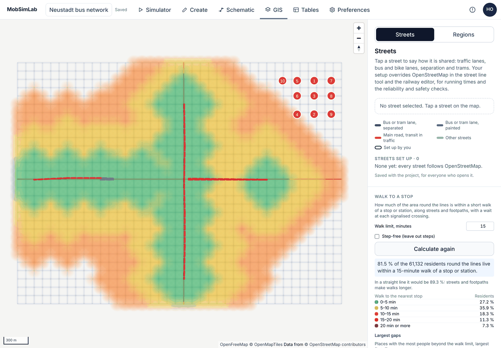

<p align="center">
  
</p>

<h1 align="center">MobSimLab</h1>

<p align="center">Mobility Simulator Lab: öffentlichen Verkehr planen, simulieren und testen.</p>

<p align="center">
  <a href="README.md">English</a> ·
  <b>Deutsch</b> ·
  <a href="README.es.md">Español</a> ·
  <a href="README.fr.md">Français</a> ·
  <a href="README.pt.md">Português</a> ·
  <a href="README.zh.md">中文</a> ·
  <a href="README.ja.md">日本語</a> ·
  <a href="README.ar.md">العربية</a> ·
  <a href="README.hi.md">हिन्दी</a>
</p>

> Dies ist eine Übersetzung. Bei Abweichungen gilt das [englische README](README.md). Die verlinkte Dokumentation ist auf Englisch.

MobSimLab ist eine quelloffene, selbst gehostete Web-App für die Planung des öffentlichen Verkehrs, GIS-Analysen und Betriebssimulation. Zeichnen Sie Bus-, Straßenbahn-, U-Bahn- und Bahnlinien auf echten Straßen- und Geländedaten, prüfen Sie, ob sie pünktlich fahren und ihre Fahrgäste aufnehmen, und sehen Sie, was sie kosten, was sie bringen und ob sich das Projekt lohnt.


## Was es kann

**Das Netz zeichnen**

- **Straßenlinien**: Bus-, BRT-, Oberleitungsbus- und Fernbuslinien, geführt über OpenStreetMap-Straßen. [Anleitung](docs/user/street-line-tool.md)
- **Eisenbahnen**: Straßenbahn, Stadtbahn, U-Bahn, S-Bahn, Regional-, Fern- und Hochgeschwindigkeitslinien mit Bahnhöfen, Gleisen, Weichen und Kreuzungen, alles maßstabsgetreu. [Anleitung](docs/user/railway-tool.md)
- **Fahrzeuge und Flotte**: ein Fahrzeugkatalog mit Quellen, dazu eigene Fahrzeuge des Projekts und seine Liste einzelner Fahrzeuge. [Anleitung](docs/user/vehicles-and-fleet.md)

**Es testen**

- **Simulator**: Passen die Bahnlinien auf die Gleise, fahren Züge und Busse pünktlich, klingen kleine Verspätungen ab, und passen alle in die Fahrzeuge? [Anleitung](docs/user/simulator.md)
- **Straßensimulation**: Straßenlinien fahren mit Eclipse SUMO im Verkehr, vom Depot und zurück, mit Wiedergabe. [Anleitung](docs/user/road-simulation.md)
- **Mehrjährige Läufe**: Jedes Simulationsjahr (standardmäßig 10, bis zu 60) läuft nach Tagesart (Werktag, Samstag, Sonntag, Feiertag) mit dem Kalender und dem Klima des Projekts. [ADR-0020](docs/adr/0020-multi-year-day-types.md)
- **Reiseplaner**: Tür-zu-Tür-Zeiten von A nach B im Tagesverlauf. [Anleitung](docs/user/journey-planner.md)

**Es analysieren**

- **Schema**: die Linien als Netzplan und als Linienbänder, Export als SVG, PNG oder PDF. [Anleitung](docs/user/schematic.md)
- **GIS**: Aufteilung der Straßen, Fußwegabdeckung und Haltestellenabstand, Bevölkerung, Regionen und die Lärmkarte. [Straßen](docs/user/gis-streets.md), [Fußwege](docs/user/gis-walk.md), [Bevölkerung](docs/user/gis-population.md), [Regionen](docs/user/gis-regions.md)
- **Tabellen**: Netz- und Flottenkennzahlen, Fahrpläne mit Fahrzeugumläufen (Download als CSV, PDF und GTFS), Kosten, Nutzen, Fahrgeldeinnahmen und Szenarienvergleich. [Netz](docs/user/network-tables.md), [Kosten](docs/user/cost-tables.md), [Nutzen](docs/user/benefit-tables.md), [Fahrgeld](docs/user/fare-revenue.md)
- **Nachfragemodell**: eine vierstufige Werktagsprognose (Verkehrserzeugung, Verkehrsverteilung, Verkehrsmittelwahl und Umlegung) mit AequilibraE. [Anleitung](docs/user/demand-model.md)
- **Bewertung**: volkswirtschaftlicher und finanzieller Kapitalwert, Renditen, Nutzen-Kosten-Verhältnis, Multikriterienanalyse, Sensitivität und Monte-Carlo-Bandbreiten. [Anleitung](docs/user/appraisal.md)

**Teilen und erweitern**

- **Projekte**: ein Projekt mit anderen teilen, es für alle Angemeldeten der Instanz öffentlich machen oder als `.mslab`-Datei speichern. [Projektdateien](docs/user/project-files.md)
- **Statischer Viewer**: eine Website ohne Server, die gespeicherte Projekte schreibgeschützt zeigt, bereit für Cloudflare Pages. [Anleitung](docs/user/static-viewer.md)
- **Plugins**: mitgelieferte Plugins bringen Seilbahnen, Fähren, People Mover, Rufbusse, Lastenräder, Energie und Emissionen, GTFS-Import und -Export und die Lärmkarte; Admins können weitere installieren, die in einer Sandbox laufen. [Mitgelieferte Plugins](plugins/README.md), [Plugins schreiben](docs/plugins/README.md)
- **KI-Agenten**: Claude oder eine andere MCP-App verbinden, um Szenarien zu erstellen und sie an der 15-Minuten-Fußwegregel zu prüfen. [Anleitung](docs/user/ai-agents.md)
- **32 Sprachen** in der App.

## Screenshots

| | |
|---|---|
|  |  |
| **Schema**: der Netzplan, mit Linienbändern und Export als SVG, PNG und PDF | **Fahrpläne**: Fahrzeugumläufe und Abfahrten je Tagesart |
|  |  |
| **Bewertung**: Lohnt sich das Projekt, und wie sicher ist das Ergebnis? | **Fußwegabdeckung**: wer in kurzer Gehweite einer Haltestelle wohnt |
|  | |
| **Lärmkarte**: L_den und L_night aus dem geplanten Betrieb, abgeschirmt durch Gebäude und Gelände | |

## Schnellstart

```bash
deploy/scripts/init-secrets          # random secrets in deploy/secrets (never committed)
cp .env.example .env                 # set MOBSIMLAB_VERSION, MOBSIMLAB_PUBLIC_URL and the OIDC provider
docker compose pull                  # ready-made image from ghcr.io, nothing to build
docker compose up -d                 # two containers: mobsimlab and postgres
open http://localhost:8080
```

Jede Version veröffentlicht ein fertiges Image für Intel/AMD- und ARM-Server unter `ghcr.io/homlo-bike/mobsimlab`, nur mit ihrer Versionsnummer getaggt (zum Beispiel `2026.11.1-alpha`; es gibt kein `latest`-Tag). Tragen Sie diese Version vor dem Pull als `MOBSIMLAB_VERSION` in `.env` ein; zum Aktualisieren ändern Sie sie auf die neuere Version und führen `docker compose pull && docker compose up -d` aus. Um das Image selbst aus diesem Checkout zu bauen, führen Sie `docker compose up -d --build` aus.

Versionen entstehen durch das Pushen eines Versions-Tags (`git tag -s v2026.11.1-alpha -m "MobSimLab 2026.11.1-alpha" && git push origin v2026.11.1-alpha`); der Workflow **Release image** baut das Image, testet es kurz und veröffentlicht es.

### Anmeldung und Ersteinrichtung

MobSimLab hat keine lokalen Passwörter; man meldet sich über einen OpenID-Connect-Anbieter an (Keycloak, Authentik, Entra ID, Google und andere).

1. Registrieren Sie MobSimLab bei Ihrem Anbieter als Webanwendung. Redirect-URI: `<MOBSIMLAB_PUBLIC_URL>/api/auth/callback`. Post-Logout-Redirect-URI: `<MOBSIMLAB_PUBLIC_URL>/`.
2. Tragen Sie die Issuer-URL und die Client-ID in `.env` ein (`MOBSIMLAB_OIDC_ISSUER`, `MOBSIMLAB_OIDC_CLIENT_ID`). Hat der Anbieter Ihnen ein Client-Secret gegeben, fügen Sie es in `deploy/secrets/oidc_client_secret` ein.
3. Starten Sie den Stack. Die Instanz startet im **Einrichtungsmodus**: Die erste Person, die sich anmeldet, wird **Owner**, alle anderen werden abgewiesen, bis der Owner **Finish setup** drückt. Um festzulegen, wer diese erste Person ist, setzen Sie `MOBSIMLAB_BOOTSTRAP_OWNER_EMAIL` (eine vom Anbieter bestätigte E-Mail) oder `MOBSIMLAB_BOOTSTRAP_OWNER_SUBJECT`.
4. Nach der Einrichtung warten neue Nutzer auf Freigabe (die automatische Registrierung ist standardmäßig aus). Owner und Admins erledigen das unter **Administration** im Kontomenü: Personen freigeben oder ablehnen, Rollen ändern (Restricted sperrt ein Konto, ohne es zu löschen), Anmelderegeln festlegen (automatische Registrierung, erlaubte E-Mail-Domains und IdP-Gruppen) und IdP-Gruppen Rollen zuordnen. Nur ein Owner kann Owner oder Admins anlegen, und der letzte Owner kann nicht entfernt werden.
5. Hinter einem TLS-Reverse-Proxy setzen Sie `MOBSIMLAB_TRUSTED_PROXIES` auf die Adresse des Proxys, damit Anmelde-Ratenbegrenzungen (standardmäßig 10 pro Minute und Client) und Audit-Einträge die echte Client-Adresse sehen.

**KI-Agenten:** Owner, Admins und Editoren können Claude oder eine andere MCP-App unter `<MOBSIMLAB_PUBLIC_URL>/mcp` verbinden. Die Instanz muss für die KI-App über HTTPS erreichbar sein, und `MOBSIMLAB_PUBLIC_URL` muss die Adresse sein, die die App verwendet. Siehe [docs/user/ai-agents.md](docs/user/ai-agents.md).

**Statischer Viewer:** `pnpm build:static` baut die schreibgeschützte Website. Siehe [docs/user/static-viewer.md](docs/user/static-viewer.md).

Owner-Konto verloren? Führen Sie `docker compose exec mobsimlab /app/bin/mobsimlab admin reset-owner` aus. Das stuft den aktuellen Owner zum Admin herab, meldet ihn ab, versetzt die Instanz zurück in den Einrichtungsmodus und vermerkt die Aktion im Audit-Log.

## Dokumentation

- [Architektur](docs/architecture/README.md), [hinterfragte Annahmen](docs/architecture/00-challenged-assumptions.md) und [Architecture Decision Records](docs/adr/README.md)
- Spike-Berichte: [S1 Co-Simulation](docs/spikes/s1-cosimulation.md), [S2 Leistung des Bahnkerns](docs/spikes/s2-rail-kernel-performance.md), [S3 OSM-Import](docs/spikes/s3-osm-import.md)

## Mitwirken

Lesen Sie zuerst [CONTRIBUTING.md](CONTRIBUTING.md) und halten Sie sich an den [Verhaltenskodex](CODE_OF_CONDUCT.md). Melden Sie Sicherheitsprobleme wie in [SECURITY.md](SECURITY.md) beschrieben. [ACCESSIBILITY.md](ACCESSIBILITY.md) beschreibt das Barrierefreiheitsziel und die bekannten Einschränkungen.

## Lizenz

Der Code steht unter der [GNU Affero General Public License v3.0 oder später](LICENSE). Der Fahrzeugkatalog, die Annahmenbibliothek und die Dokumentation stehen unter CC BY 4.0.
