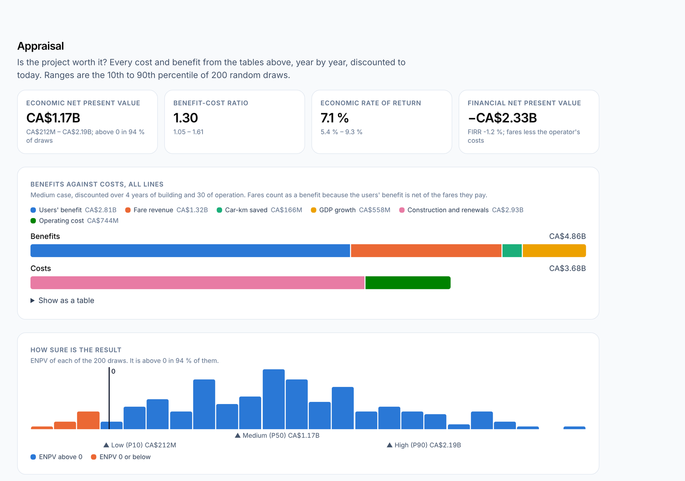

<p align="center">
  
</p>

<h1 align="center">MobSimLab</h1>

<p align="center">Mobility Simulator Lab：公共交通を計画し、シミュレートし、検証する。</p>

<p align="center">
  <a href="README.md">English</a> ·
  <a href="README.de.md">Deutsch</a> ·
  <a href="README.es.md">Español</a> ·
  <a href="README.fr.md">Français</a> ·
  <a href="README.pt.md">Português</a> ·
  <a href="README.zh.md">中文</a> ·
  <b>日本語</b> ·
  <a href="README.ar.md">العربية</a> ·
  <a href="README.hi.md">हिन्दी</a>
</p>

> これは翻訳です。内容に違いがある場合は[英語版 README](README.md) が優先されます。リンク先のドキュメントは英語です。

MobSimLab は、公共交通の計画、GIS 分析、運行シミュレーションのためのオープンソースのセルフホスト型 Web アプリです。実際の道路データと地形データの上にバス、路面電車、地下鉄、鉄道の路線を描き、定時に走れるか、乗客を乗せきれるかを検証し、費用と効果、そしてプロジェクトに価値があるかを確認できます。


## できること

**路線網を描く**

- **道路路線**：OpenStreetMap の道路に沿って、バス、BRT、トロリーバス、都市間バスの路線を設定します。[ガイド](docs/user/street-line-tool.md)
- **鉄道**：路面電車、LRT、地下鉄、通勤鉄道、地域鉄道、都市間鉄道、高速鉄道を、駅、線路、分岐器、交差とともにすべて実寸で設計します。[ガイド](docs/user/railway-tool.md)
- **車両と車両編成**：出典付きの車両カタログに加え、プロジェクト独自の車両と個々の車両の一覧。[ガイド](docs/user/vehicles-and-fleet.md)

**検証する**

- **シミュレーター**：鉄道路線が線路に収まるか、列車とバスが定時に走るか、小さな遅れが収束するか、全員が車両に乗れるか。[ガイド](docs/user/simulator.md)
- **道路シミュレーション**：Eclipse SUMO で道路路線を一般交通の中で走らせ、車庫を出て戻るまでを再生できます。[ガイド](docs/user/road-simulation.md)
- **複数年の実行**：各シミュレーション年（既定 10 年、最大 60 年）を、プロジェクトのカレンダーと気候に基づき日種別（平日、土曜、日曜、祝日）ごとに実行します。[ADR-0020](docs/adr/0020-multi-year-day-types.md)
- **経路検索**：一日を通した A から B までのドアツードアの所要時間。[ガイド](docs/user/journey-planner.md)

**分析する**

- **路線図**：路線をネットワーク図と路線ごとのストリップマップとして描き、SVG、PNG、PDF で書き出せます。[ガイド](docs/user/schematic.md)
- **GIS**：道路の使い分け、徒歩圏カバー率と停留所間隔、人口、地域、騒音マップ。[道路](docs/user/gis-streets.md)、[徒歩](docs/user/gis-walk.md)、[人口](docs/user/gis-population.md)、[地域](docs/user/gis-regions.md)
- **表**：路線網と車両の数値、車両運用付きの時刻表（CSV、PDF、GTFS でダウンロード）、費用、便益、運賃収入、シナリオ比較。[路線網](docs/user/network-tables.md)、[費用](docs/user/cost-tables.md)、[便益](docs/user/benefit-tables.md)、[運賃](docs/user/fare-revenue.md)
- **需要モデル**：AequilibraE による平日の四段階推定（発生、分布、交通手段選択、配分）。[ガイド](docs/user/demand-model.md)
- **事業評価**：経済的・財務的な正味現在価値、内部収益率、費用便益比、多基準分析、感度分析、モンテカルロによる幅。[ガイド](docs/user/appraisal.md)

**共有と拡張**

- **プロジェクト**：他の人と共有したり、インスタンスにサインインしている全員に公開したり、`.mslab` ファイルとして保存したりできます。[プロジェクトファイル](docs/user/project-files.md)
- **静的ビューアー**：保存したプロジェクトを読み取り専用で表示する、サーバー不要の Web サイト。Cloudflare Pages にそのまま置けます。[ガイド](docs/user/static-viewer.md)
- **プラグイン**：同梱プラグインがロープウェイ、フェリー、ピープルムーバー、デマンドバス、カーゴバイク、エネルギーと排出量、GTFS の入出力、騒音マップを追加します。管理者は他のプラグインもインストールでき、それらはサンドボックス内で動きます。[同梱プラグイン](plugins/README.md)、[プラグインの作成](docs/plugins/README.md)
- **AI エージェント**：Claude などの MCP アプリを接続してシナリオを作り、徒歩 15 分ルールで検証できます。[ガイド](docs/user/ai-agents.md)
- アプリは **32 言語**に対応しています。

## スクリーンショット

| | |
|---|---|
|  |  |
| **路線図**：ネットワーク図。ストリップマップと SVG、PNG、PDF の書き出しも | **時刻表**：日種別ごとの車両運用と発車時刻 |
|  |  |
| **事業評価**：プロジェクトに価値はあるか、結果はどれほど確かか | **徒歩圏カバー率**：停留所から歩いてすぐの範囲に住む人 |
|  | |
| **騒音マップ**：計画運行による L_den と L_night。建物と地形による遮蔽を考慮 | |

## クイックスタート

```bash
deploy/scripts/init-secrets          # random secrets in deploy/secrets (never committed)
cp .env.example .env                 # set MOBSIMLAB_VERSION, MOBSIMLAB_PUBLIC_URL and the OIDC provider
docker compose pull                  # ready-made image from ghcr.io, nothing to build
docker compose up -d                 # two containers: mobsimlab and postgres
open http://localhost:8080
```

各リリースでは、Intel/AMD と ARM のサーバー向けのビルド済みイメージを `ghcr.io/homlo-bike/mobsimlab` に公開します。タグはバージョン番号のみです（例：`2026.11.1-alpha`。`latest` タグはありません）。pull の前にそのバージョンを `.env` の `MOBSIMLAB_VERSION` に設定してください。更新するときは新しいバージョンに書き換えて `docker compose pull && docker compose up -d` を実行します。このリポジトリから自分でイメージをビルドする場合は `docker compose up -d --build` を実行します。

リリースはバージョンタグを push して作成します（`git tag -s v2026.11.1-alpha -m "MobSimLab 2026.11.1-alpha" && git push origin v2026.11.1-alpha`）。**Release image** ワークフローがイメージをビルドし、スモークテストを行い、公開します。

### サインインと初期設定

MobSimLab にはローカルのパスワードはありません。OpenID Connect プロバイダー（Keycloak、Authentik、Entra ID、Google など）でサインインします。

1. プロバイダーに MobSimLab を Web アプリケーションとして登録します。リダイレクト URI：`<MOBSIMLAB_PUBLIC_URL>/api/auth/callback`。ログアウト後のリダイレクト URI：`<MOBSIMLAB_PUBLIC_URL>/`。
2. 発行者 URL とクライアント ID を `.env` に記入します（`MOBSIMLAB_OIDC_ISSUER`、`MOBSIMLAB_OIDC_CLIENT_ID`）。プロバイダーからクライアントシークレットを受け取った場合は、`deploy/secrets/oidc_client_secret` に貼り付けます。
3. スタックを起動します。インスタンスは**セットアップモード**で起動し、最初にサインインした人が **Owner** になります。Owner が **Finish setup** を押すまで、他の人は拒否されます。この最初の人を指定するには、`MOBSIMLAB_BOOTSTRAP_OWNER_EMAIL`（プロバイダーが確認済みのメールアドレス）または `MOBSIMLAB_BOOTSTRAP_OWNER_SUBJECT` を設定します。
4. セットアップ後、新しいユーザーは承認待ちになります（自動登録は既定でオフ）。Owner と Admin はアカウントメニューの **Administration** で、ユーザーの承認・拒否、ロールの変更（Restricted はアカウントを削除せずに停止）、登録ルール（自動登録、許可するメールドメインと IdP グループ）の設定、IdP グループとロールの対応付けを行います。Owner や Admin を作れるのは Owner だけで、最後の Owner は削除できません。
5. TLS リバースプロキシの背後で動かす場合は、`MOBSIMLAB_TRUSTED_PROXIES` にプロキシのアドレスを設定してください。サインインの回数制限（既定でクライアントごとに毎分 10 回）と監査記録が実際のクライアントアドレスを参照できるようになります。

**AI エージェント：** Owner、Admin、Editor は `<MOBSIMLAB_PUBLIC_URL>/mcp` で Claude などの MCP アプリを接続できます。インスタンスは AI アプリから HTTPS で到達できる必要があり、`MOBSIMLAB_PUBLIC_URL` はアプリが使うアドレスでなければなりません。[docs/user/ai-agents.md](docs/user/ai-agents.md) を参照してください。

**静的ビューアー：** `pnpm build:static` で読み取り専用の Web サイトをビルドします。[docs/user/static-viewer.md](docs/user/static-viewer.md) を参照してください。

Owner アカウントを失った場合は、`docker compose exec mobsimlab /app/bin/mobsimlab admin reset-owner` を実行します。現在の Owner を Admin に降格してサインアウトさせ、インスタンスをセットアップモードに戻し、その操作を監査ログに記録します。

## ドキュメント

- [アーキテクチャ](docs/architecture/README.md)、[見直した前提](docs/architecture/00-challenged-assumptions.md)、[アーキテクチャ決定記録](docs/adr/README.md)
- 技術検証レポート：[S1 連成シミュレーション](docs/spikes/s1-cosimulation.md)、[S2 鉄道カーネルの性能](docs/spikes/s2-rail-kernel-performance.md)、[S3 OSM インポート](docs/spikes/s3-osm-import.md)

## 貢献

まず [CONTRIBUTING.md](CONTRIBUTING.md) を読み、[行動規範](CODE_OF_CONDUCT.md)に従ってください。セキュリティ上の問題は [SECURITY.md](SECURITY.md) の手順で報告してください。[ACCESSIBILITY.md](ACCESSIBILITY.md) にはアクセシビリティの目標と既知の制限が書かれています。

## ライセンス

コードは [GNU Affero General Public License v3.0 以降](LICENSE)で提供されます。車両カタログ、前提値ライブラリ、ドキュメントは CC BY 4.0 で提供されます。
