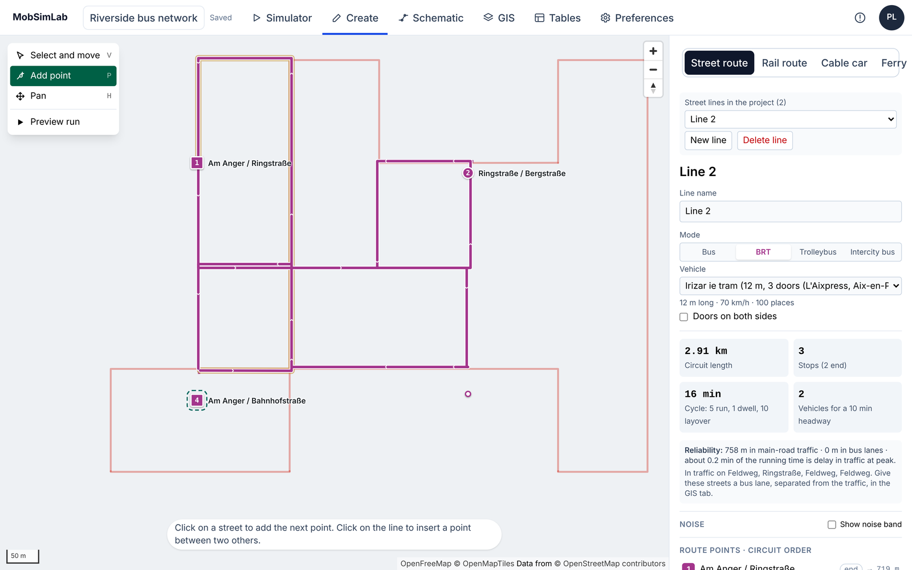
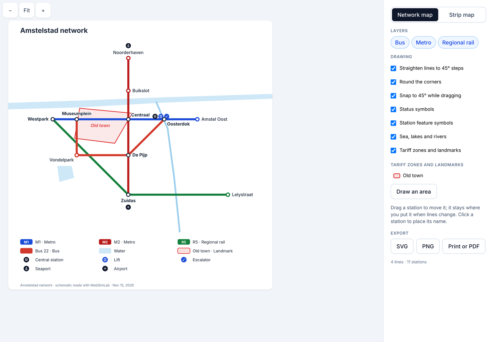

<p align="center">
  
</p>

<h1 align="center">MobSimLab</h1>

<p align="center">Mobility Simulator Lab: planejar, simular e testar o transporte público.</p>

<p align="center">
  <a href="README.md">English</a> ·
  <a href="README.de.md">Deutsch</a> ·
  <a href="README.es.md">Español</a> ·
  <a href="README.fr.md">Français</a> ·
  <b>Português</b> ·
  <a href="README.zh.md">中文</a> ·
  <a href="README.ja.md">日本語</a> ·
  <a href="README.ar.md">العربية</a> ·
  <a href="README.hi.md">हिन्दी</a>
</p>

> Esta é uma tradução. Em caso de diferença, vale o [README em inglês](README.md). A documentação vinculada está em inglês.

O MobSimLab é um aplicativo web de código aberto e auto-hospedado para planejamento de transporte público, análise SIG e simulação de operação. Desenhe linhas de ônibus, bonde, metrô e trem sobre dados reais de ruas e relevo, teste se cumprem o horário e comportam seus passageiros, e veja quanto custam, o que trazem e se o projeto vale a pena.



## O que ele faz

**Desenhar a rede**

- **Linhas de rua**: linhas de ônibus, BRT, trólebus e ônibus intermunicipal traçadas nas ruas do OpenStreetMap. [Guia](docs/user/street-line-tool.md)
- **Ferrovias**: bonde, VLT, metrô, trem metropolitano, regional, intercidades e alta velocidade, com estações, vias, aparelhos de mudança de via e cruzamentos, tudo em escala. [Guia](docs/user/railway-tool.md)
- **Veículos e frota**: um catálogo de veículos com fontes, mais os veículos próprios do projeto e sua lista de veículos individuais. [Guia](docs/user/vehicles-and-fleet.md)

**Testá-la**

- **Simulador**: as linhas ferroviárias cabem nas vias, trens e ônibus cumprem o horário, pequenos atrasos se dissipam e todos cabem nos veículos? [Guia](docs/user/simulator.md)
- **Simulação viária**: as linhas de rua rodam no trânsito com o Eclipse SUMO, saindo das garagens e voltando, com reprodução. [Guia](docs/user/road-simulation.md)
- **Execuções plurianuais**: cada ano de simulação (10 por padrão, até 60) roda por tipo de dia (dia útil, sábado, domingo, feriado) com o calendário e o clima do projeto. [ADR-0020](docs/adr/0020-multi-year-day-types.md)
- **Planejador de viagens**: tempos porta a porta de A a B ao longo do dia. [Guia](docs/user/journey-planner.md)

**Analisá-la**

- **Esquema**: as linhas como mapa da rede e como diagramas de linha, exportados em SVG, PNG ou PDF. [Guia](docs/user/schematic.md)
- **SIG**: como as ruas são compartilhadas, cobertura a pé e espaçamento de paradas, população, regiões e o mapa de ruído. [Ruas](docs/user/gis-streets.md), [a pé](docs/user/gis-walk.md), [população](docs/user/gis-population.md), [regiões](docs/user/gis-regions.md)
- **Tabelas**: números da rede e da frota, horários com blocos de veículos (downloads em CSV, PDF e GTFS), custos, benefícios, receita tarifária e comparação de cenários. [Rede](docs/user/network-tables.md), [custos](docs/user/cost-tables.md), [benefícios](docs/user/benefit-tables.md), [tarifas](docs/user/fare-revenue.md)
- **Modelo de demanda**: uma previsão de dia útil em quatro etapas (geração, distribuição, divisão modal e alocação) com o AequilibraE. [Guia](docs/user/demand-model.md)
- **Avaliação**: valor presente líquido econômico e financeiro, taxas de retorno, relação benefício-custo, análise multicritério, sensibilidade e intervalos de Monte Carlo. [Guia](docs/user/appraisal.md)

**Compartilhar e ampliar**

- **Projetos**: compartilhe um projeto com outras pessoas, torne-o público para todos os usuários da instância ou salve-o como arquivo `.mslab`. [Arquivos de projeto](docs/user/project-files.md)
- **Visualizador estático**: um site sem servidor que mostra projetos salvos somente para leitura, pronto para o Cloudflare Pages. [Guia](docs/user/static-viewer.md)
- **Plugins**: os plugins incluídos acrescentam teleféricos, balsas, people movers, ônibus sob demanda, bicicletas de carga, energia e emissões, importação e exportação GTFS e o mapa de ruído; administradores podem instalar outros, que rodam em uma sandbox. [Plugins incluídos](plugins/README.md), [criar plugins](docs/plugins/README.md)
- **Agentes de IA**: conecte o Claude ou outro aplicativo MCP para montar cenários e verificá-los pela regra dos 15 minutos a pé. [Guia](docs/user/ai-agents.md)
- **32 idiomas** no aplicativo.

## Capturas de tela

| | |
|---|---|
|  |  |
| **Esquema**: o mapa da rede, com diagramas de linha e exportação em SVG, PNG e PDF | **Horários**: blocos de veículos e partidas por tipo de dia |
|  |  |
| **Avaliação**: o projeto vale a pena, e quão seguro é o resultado? | **Cobertura a pé**: quem mora a uma curta caminhada de uma parada |
|  | |
| **Mapa de ruído**: L_den e L_night do serviço planejado, com a barreira dos edifícios e do relevo | |

## Início rápido

```bash
deploy/scripts/init-secrets          # random secrets in deploy/secrets (never committed)
cp .env.example .env                 # set MOBSIMLAB_VERSION, MOBSIMLAB_PUBLIC_URL and the OIDC provider
docker compose pull                  # ready-made image from ghcr.io, nothing to build
docker compose up -d                 # two containers: mobsimlab and postgres
open http://localhost:8080
```

Cada versão publica uma imagem pronta para servidores Intel/AMD e ARM em `ghcr.io/homlo-bike/mobsimlab`, marcada apenas com o número da versão (por exemplo `2026.11.1-alpha`; não existe a tag `latest`). Defina essa versão como `MOBSIMLAB_VERSION` no `.env` antes de baixar; para atualizar, troque pela versão mais nova e execute `docker compose pull && docker compose up -d`. Para construir a imagem você mesmo a partir deste repositório, execute `docker compose up -d --build`.

As versões são criadas ao enviar uma tag de versão (`git tag -s v2026.11.1-alpha -m "MobSimLab 2026.11.1-alpha" && git push origin v2026.11.1-alpha`); o workflow **Release image** constrói, testa e publica a imagem.

### Login e primeira configuração

O MobSimLab não tem senhas locais; as pessoas entram com um provedor OpenID Connect (Keycloak, Authentik, Entra ID, Google e outros).

1. Registre o MobSimLab no seu provedor como aplicativo web. URI de redirecionamento: `<MOBSIMLAB_PUBLIC_URL>/api/auth/callback`. URI de redirecionamento após o logout: `<MOBSIMLAB_PUBLIC_URL>/`.
2. Coloque a URL do emissor e o ID do cliente no `.env` (`MOBSIMLAB_OIDC_ISSUER`, `MOBSIMLAB_OIDC_CLIENT_ID`). Se o provedor forneceu um segredo de cliente, cole-o em `deploy/secrets/oidc_client_secret`.
3. Inicie os contêineres. A instância começa em **modo de configuração**: a primeira pessoa que entra vira **Owner**, e todas as outras são recusadas até o Owner clicar em **Finish setup**. Para escolher quem é essa primeira pessoa, defina `MOBSIMLAB_BOOTSTRAP_OWNER_EMAIL` (um e-mail verificado pelo provedor) ou `MOBSIMLAB_BOOTSTRAP_OWNER_SUBJECT`.
4. Depois da configuração, novos usuários aguardam aprovação (o cadastro automático vem desligado). Owners e Admins cuidam disso em **Administration**, no menu da conta: aprovar ou recusar pessoas, mudar papéis (Restricted suspende uma conta sem apagá-la), definir regras de cadastro (cadastro automático, domínios de e-mail e grupos do IdP permitidos) e associar grupos do IdP a papéis. Só um Owner pode criar Owners ou Admins, e o último Owner não pode ser removido.
5. Atrás de um proxy reverso TLS, defina `MOBSIMLAB_TRUSTED_PROXIES` com o endereço do proxy para que os limites de login (10 por minuto por cliente, por padrão) e os registros de auditoria vejam o endereço real do cliente.

**Agentes de IA:** Owners, Admins e Editors podem conectar o Claude ou outro aplicativo MCP em `<MOBSIMLAB_PUBLIC_URL>/mcp`. A instância precisa ser acessível por HTTPS a partir do aplicativo de IA, e `MOBSIMLAB_PUBLIC_URL` precisa ser o endereço que o aplicativo usa. Veja [docs/user/ai-agents.md](docs/user/ai-agents.md).

**Visualizador estático:** `pnpm build:static` constrói o site somente leitura. Veja [docs/user/static-viewer.md](docs/user/static-viewer.md).

Perdeu a conta de Owner? Execute `docker compose exec mobsimlab /app/bin/mobsimlab admin reset-owner`. Isso rebaixa o Owner atual a Admin, encerra a sessão dele, volta a instância ao modo de configuração e registra a ação no log de auditoria.

## Documentação

- [Arquitetura](docs/architecture/README.md), [premissas questionadas](docs/architecture/00-challenged-assumptions.md) e [registros de decisões de arquitetura](docs/adr/README.md)
- Relatórios de prova de conceito: [S1 cossimulação](docs/spikes/s1-cosimulation.md), [S2 desempenho do núcleo ferroviário](docs/spikes/s2-rail-kernel-performance.md), [S3 importação do OSM](docs/spikes/s3-osm-import.md)

## Contribuir

Leia primeiro o [CONTRIBUTING.md](CONTRIBUTING.md) e siga o [código de conduta](CODE_OF_CONDUCT.md). Relate problemas de segurança como descrito em [SECURITY.md](SECURITY.md). O [ACCESSIBILITY.md](ACCESSIBILITY.md) apresenta a meta de acessibilidade e as limitações conhecidas.

## Licença

O código está sob a [GNU Affero General Public License v3.0 ou posterior](LICENSE). O catálogo de veículos, a biblioteca de premissas e a documentação estão sob CC BY 4.0.
