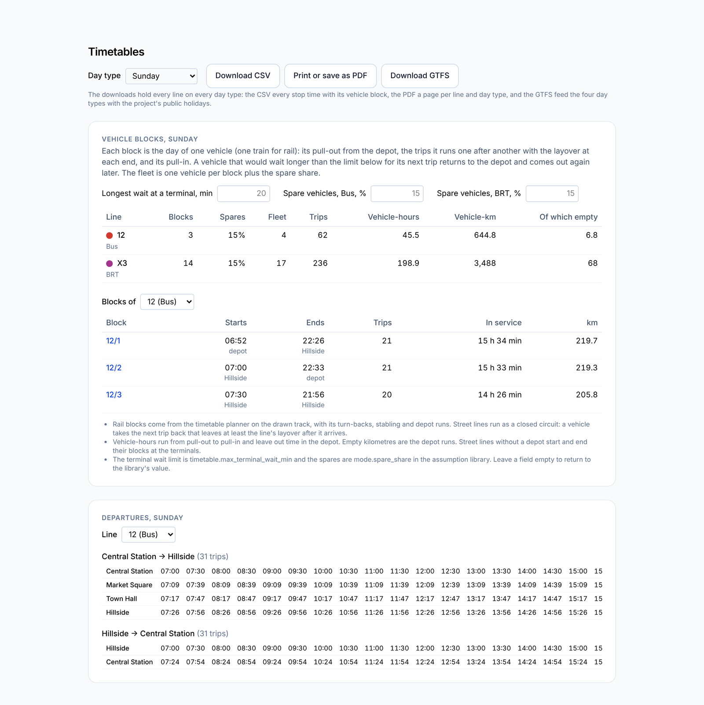
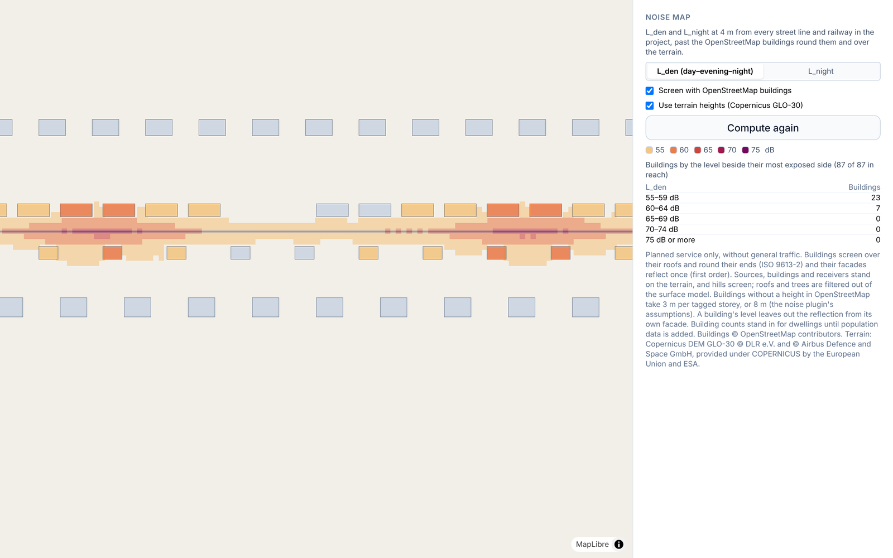

<p align="center">
  
</p>

<h1 align="center">MobSimLab</h1>

<p align="center">Mobility Simulator Lab：规划、模拟和测试公共交通。</p>

<p align="center">
  <a href="README.md">English</a> ·
  <a href="README.de.md">Deutsch</a> ·
  <a href="README.es.md">Español</a> ·
  <a href="README.fr.md">Français</a> ·
  <a href="README.pt.md">Português</a> ·
  <b>中文</b> ·
  <a href="README.ja.md">日本語</a> ·
  <a href="README.ar.md">العربية</a> ·
  <a href="README.hi.md">हिन्दी</a>
</p>

> 本文为译文，如有出入，以[英文 README](README.md) 为准。所链接的文档为英文。

MobSimLab 是一款开源、可自行部署的 Web 应用，用于公共交通规划、GIS 分析和运营模拟。在真实的街道和地形数据上绘制公交、有轨电车、地铁和铁路线路，检验它们能否准点运行、能否容纳乘客，并了解它们的成本、收益以及项目是否值得。


## 功能

**绘制线网**

- **街道线路**：在 OpenStreetMap 街道上规划公交、BRT、无轨电车和城际客车线路。[指南](docs/user/street-line-tool.md)
- **铁路**：有轨电车、轻轨、地铁、市郊铁路、区域铁路、城际和高速铁路，包括车站、轨道、道岔和交叉，全部按比例绘制。[指南](docs/user/railway-tool.md)
- **车辆与车队**：带出处的车辆目录，以及项目自有车辆和单车清单。[指南](docs/user/vehicles-and-fleet.md)

**测试**

- **模拟器**：铁路线路是否与轨道匹配，列车和公交是否准点，小延误能否消散，车辆能否容纳所有乘客。[指南](docs/user/simulator.md)
- **道路模拟**：用 Eclipse SUMO 让街道线路在交通流中运行，从车场出发再返回，并可回放。[指南](docs/user/road-simulation.md)
- **多年运行**：每个模拟年份（默认 10 年，最多 60 年）按日类型（工作日、周六、周日、公共假日）结合项目的日历和气候运行。[ADR-0020](docs/adr/0020-multi-year-day-types.md)
- **出行规划**：全天从 A 到 B 的门到门出行时间。[指南](docs/user/journey-planner.md)

**分析**

- **示意图**：将线路绘制成线网图和单线图，可导出为 SVG、PNG 或 PDF。[指南](docs/user/schematic.md)
- **GIS**：街道使用方式、步行覆盖和站距、人口、区域以及噪声地图。[街道](docs/user/gis-streets.md)、[步行](docs/user/gis-walk.md)、[人口](docs/user/gis-population.md)、[区域](docs/user/gis-regions.md)
- **表格**：线网与车队数据、含车辆排班的时刻表（可下载 CSV、PDF 和 GTFS）、成本、效益、票款收入和方案比较。[线网](docs/user/network-tables.md)、[成本](docs/user/cost-tables.md)、[效益](docs/user/benefit-tables.md)、[票价](docs/user/fare-revenue.md)
- **需求模型**：基于 AequilibraE 的工作日四阶段预测（出行生成、出行分布、方式划分和交通分配）。[指南](docs/user/demand-model.md)
- **评估**：经济和财务净现值、收益率、效益成本比、多准则分析、敏感性分析和蒙特卡洛区间。[指南](docs/user/appraisal.md)

**共享与扩展**

- **项目**：与他人共享项目，对实例中所有已登录用户公开，或保存为 `.mslab` 文件。[项目文件](docs/user/project-files.md)
- **静态查看器**：无需服务器的网站，以只读方式展示已保存的项目，可直接部署到 Cloudflare Pages。[指南](docs/user/static-viewer.md)
- **插件**：内置插件提供索道、渡轮、需求响应公交、货运自行车、能源与排放、GTFS 导入导出和噪声地图；管理员还可安装其他插件，它们在沙箱中运行。[内置插件](plugins/README.md)、[编写插件](docs/plugins/README.md)
- **AI 智能体**：连接 Claude 或其他 MCP 应用来构建方案，并按 15 分钟步行规则检验。[指南](docs/user/ai-agents.md)
- 应用支持 **32 种语言**。

## 截图

| | |
|---|---|
|  |  |
| **示意图**：线网图，另有单线图以及 SVG、PNG 和 PDF 导出 | **时刻表**：按日类型的车辆排班和发车时刻 |
|  |  |
| **评估**：项目是否值得，结果有多可靠 | **步行覆盖**：哪些人住在车站的短途步行范围内 |
|  | |
| **噪声地图**：规划运营产生的 L_den 和 L_night，考虑建筑和地形的遮挡 | |

## 快速开始

```bash
deploy/scripts/init-secrets          # random secrets in deploy/secrets (never committed)
cp .env.example .env                 # set MOBSIMLAB_VERSION, MOBSIMLAB_PUBLIC_URL and the OIDC provider
docker compose pull                  # ready-made image from ghcr.io, nothing to build
docker compose up -d                 # two containers: mobsimlab and postgres
open http://localhost:8080
```

每个版本都会在 `ghcr.io/homlo-bike/mobsimlab` 发布适用于 Intel/AMD 和 ARM 服务器的现成镜像，只使用版本号作为标签（例如 `2026.11.1-alpha`；没有 `latest` 标签）。拉取前请在 `.env` 中将该版本设为 `MOBSIMLAB_VERSION`；升级时改为更新的版本并运行 `docker compose pull && docker compose up -d`。如需从本仓库自行构建镜像，请运行 `docker compose up -d --build`。

发布版本的方式是推送版本标签（`git tag -s v2026.11.1-alpha -m "MobSimLab 2026.11.1-alpha" && git push origin v2026.11.1-alpha`）；**Release image** 工作流会构建镜像、做冒烟测试并发布。

### 登录与初始设置

MobSimLab 没有本地密码；用户通过 OpenID Connect 提供方登录（Keycloak、Authentik、Entra ID、Google 等）。

1. 在你的提供方处将 MobSimLab 注册为 Web 应用。重定向 URI：`<MOBSIMLAB_PUBLIC_URL>/api/auth/callback`。登出后重定向 URI：`<MOBSIMLAB_PUBLIC_URL>/`。
2. 在 `.env` 中填写签发者 URL 和客户端 ID（`MOBSIMLAB_OIDC_ISSUER`、`MOBSIMLAB_OIDC_CLIENT_ID`）。如果提供方给了客户端密钥，请粘贴到 `deploy/secrets/oidc_client_secret`。
3. 启动服务。实例以**设置模式**启动：第一个登录的人成为 **Owner**，在 Owner 点击 **Finish setup** 之前，其他人都会被拒绝。要指定这第一个人，请设置 `MOBSIMLAB_BOOTSTRAP_OWNER_EMAIL`（经提供方验证的电子邮件）或 `MOBSIMLAB_BOOTSTRAP_OWNER_SUBJECT`。
4. 设置完成后，新用户需等待审批（默认关闭自动注册）。Owner 和 Admin 在账户菜单的 **Administration** 中处理：批准或拒绝用户、更改角色（Restricted 会停用账户但不删除）、设置注册规则（自动注册、允许的邮件域名和 IdP 组），以及将 IdP 组映射到角色。只有 Owner 能创建 Owner 或 Admin，最后一个 Owner 不能被移除。
5. 如果部署在 TLS 反向代理之后，请将 `MOBSIMLAB_TRUSTED_PROXIES` 设为代理地址，以便登录频率限制（默认每个客户端每分钟 10 次）和审计记录获取真实的客户端地址。

**AI 智能体：** Owner、Admin 和 Editor 可以在 `<MOBSIMLAB_PUBLIC_URL>/mcp` 连接 Claude 或其他 MCP 应用。AI 应用必须能通过 HTTPS 访问该实例，且 `MOBSIMLAB_PUBLIC_URL` 必须是应用所用的地址。参见 [docs/user/ai-agents.md](docs/user/ai-agents.md)。

**静态查看器：** `pnpm build:static` 用于构建只读网站。参见 [docs/user/static-viewer.md](docs/user/static-viewer.md)。

Owner 账户丢失？运行 `docker compose exec mobsimlab /app/bin/mobsimlab admin reset-owner`。该命令会将当前 Owner 降为 Admin、将其登出、使实例回到设置模式，并在审计日志中记录此操作。

## 文档

- [架构](docs/architecture/README.md)、[经过质疑的假设](docs/architecture/00-challenged-assumptions.md)和[架构决策记录](docs/adr/README.md)
- 技术验证报告：[S1 联合仿真](docs/spikes/s1-cosimulation.md)、[S2 铁路内核性能](docs/spikes/s2-rail-kernel-performance.md)、[S3 OSM 导入](docs/spikes/s3-osm-import.md)

## 参与贡献

请先阅读 [CONTRIBUTING.md](CONTRIBUTING.md)，并遵守[行为准则](CODE_OF_CONDUCT.md)。安全问题请按 [SECURITY.md](SECURITY.md) 中的说明报告。[ACCESSIBILITY.md](ACCESSIBILITY.md) 说明了无障碍目标和已知限制。

## 许可证

代码采用 [GNU Affero General Public License v3.0 或更高版本](LICENSE)。车辆目录、假设库和文档采用 CC BY 4.0。
