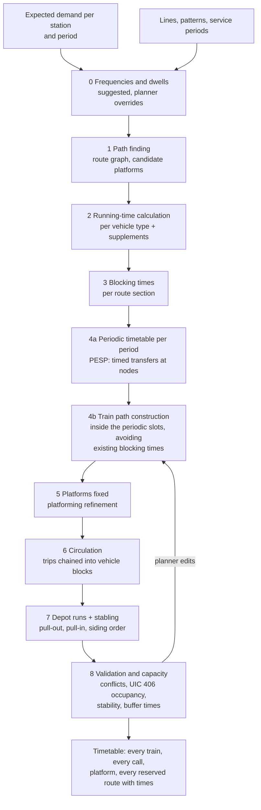

# ADR-0032: Railway operations management: rail lines from stations, conflict-free timetables on blocking times, and a traffic management layer that reschedules

- Status: Accepted (product owner approval, 2026-11-01)
- Date: 2026-10-28, revised 2026-11-01
- Deciders: product owner, architecture
- Related: FR-NET-10, FR-NET-11, FR-SIM-02, FR-SIM-04, FR-SIM-07, FR-SIM-09, FR-TT-01..06, NFR-PERF-03, NFR-ACC-01/02, ADR-0006 (rail kernel), ADR-0007 (co-simulation), ADR-0028 (persistence), ADR-0029 (street lines), ADR-0030 (railway design tool), [07 §4, §9, §11](../architecture/07-simulation.md), [spike S2](../spikes/s2-rail-kernel-performance.md)

## Context

The product owner asked for a railway operations system, not only a router (2026-10-28):

1. The planner creates a **rail service line by picking stations or platforms**. Stations with the same name are **one station in two (or more) parts**.
2. The system produces the **schedule of every train**: arrival and departure at every station, the **platform** (when the planner did not fix one), and when each train **leaves the depot and returns to it**.
3. It **reserves and blocks track sections and platforms**, makes sure every train runs at the **right speed on every section**, keeps its **distance** to other trains and is **where it should be at every second**, and that **no collision or overlap ever happens**.
4. It is **dynamic**: when a signal, switch or vehicle fails, it adjusts the plan.

The product owner's answers to the first review (2026-11-01) add:

5. **Service periods and frequencies from demand.** Days have peak, off-peak and no-service hours. The system calculates and suggests the frequency of each period from expected demand; the planner can override it for the project or for one line. Dwell times follow the demand at each station.
6. **The Swiss approach: punctuality before speed**, and lines that **meet in the same time window at transfer stations** so passengers change without waiting.
7. **Passengers prefer the same platform for the same destination**, so platform choice must be consistent.
8. **Capacity**: how much of the infrastructure each line uses, and the maximum before delays start to pile up.
9. **Automatic short-turns and cancellations are allowed** when a train cannot continue; the vehicle then serves another line or returns to the depot.
10. **Live records and boards**: for any station, the next 5 arrivals with expected time, delay, platform and platform changes; for any train, its next 5 stops with the same information.
11. **Reverse in the platform at the ends of a line by default**, as long as this does not block other trains.

ADR-0006 already decided a custom Rust kernel with fixed-block interlocking, and spike S2 showed 2,000 trains a day at about 13,000× real time with exclusive section reservation. 07 §4 and §11 sketch dispatching, platform assignment, rerouting and a blocking-time conflict check, but not how lines are authored, how the timetable is constructed, how depots are worked, or how disruptions are handled. ADR-0030 and the railway design tool (`crates/rail-design`, in progress) own the track, station, switch and signal geometry.

Railway operations is a mature field with standard methods. We use them rather than inventing our own:

| Need | Established method | Reference |
|------|--------------------|-----------|
| Minimum running time | Running-time calculation by numerical integration of tractive effort, resistance (Davis), gradient and curves; braking curves | Brünger & Dahlhaus, "Running time estimation", in Hansen & Pachl (eds.), *Railway Timetabling & Operations*, 2nd ed., 2014 |
| Track occupation and headway | **Blocking time theory** (blocking time stairway): each block or route section is blocked from route setting to release | Pachl, *Railway Operation and Control*; UIC Code 406 (capacity), 2nd ed., 2013 |
| Timetable supplements | Running-time supplements and buffer times | UIC Code 451-1 |
| Frequency from demand | Maximum load point and load profile methods, with a policy (minimum) headway | Ceder, *Public Transit Planning and Operation*, 2nd ed., 2016 |
| Clock-face timetables with timed transfers (Swiss *Integraler Taktfahrplan*) | Periodic Event Scheduling Problem (**PESP**), with transfer constraints at nodes and the symmetry minute | Serafini & Ukovich, *SIAM J. Discrete Math.* 2(4), 1989; Liebchen, PhD thesis, TU Berlin, 2006; Caimi et al., "Periodic railway timetabling with event flexibility", *Networks* 57(1), 2011 (SBB) |
| Capacity consumption | **UIC 406 compression method** (blocking time stairways pushed together) and occupancy limits | UIC Code 406, 2nd ed., 2013 |
| Stability and knock-on delays | Monte Carlo delay propagation with seeded primary delays | Hansen & Pachl 2014 |
| Inserting a train into an existing plan | Space-time path search around existing blocking times (OSRD's STDCM, "short term digital capacity management") | OSRD documentation, *STDCM* |
| Platform assignment | **Train platforming problem**: conflict graph and assignment | Caprara, Galli & Toth, *Transportation Science* 45(2), 2011 |
| Rolling stock circulation | Trip chaining as an assignment / minimum-cost flow problem | Hansen & Pachl 2014; Ahuja, Magnanti & Orlin, *Network Flows*, 1993 |
| Depot stabling | Train unit shunting and track assignment on stabling sidings (LIFO on dead-end tracks) | Lentink, PhD thesis, Erasmus Univ. Rotterdam, 2006 |
| Interlocking | Routes from signal to signal, overlaps, flank protection, approach locking, sectional release | Pachl; DB Ril 819 (already cited for overlaps in the assumption library) |
| Moving block | ETCS Level 2 / CBTC movement authority to the rear of the train ahead with braking curves | IEEE 1474.1 (CBTC); ERA *ETCS Subset-026* |
| Real-time rescheduling | **Alternative graph** (job shop with blocking) for retiming and reordering; rerouting with K shortest paths | Mascis & Pacciarelli, *EJOR* 143(3), 2002; D'Ariano, Pacciarelli & Pranzo, *EJOR* 183(2), 2007 (ROMA); Yen, *Management Science* 17(11), 1971 |

## Decision

### 1. Shared infrastructure model, compiled for operations

- `crates/rail-design` (ADR-0030) stays the owner of geometry, stations, switches and signal placement. It exports a **topology** with stable ids: track sections with speed, gradient and curve profiles; switch nodes with legs, diverging speeds and fouling points; platform edges with chainage, length, height and side; signals with position, direction and type; the signalling system per area (line of sight, fixed block, ETCS L2, CBTC); storage tracks grouped into depots. A JSON Schema in `contracts/` describes the export so both sides test against the same file.
- A new crate `crates/rail-model` **compiles** the export into the operations model the kernel and the planner share:
  - **Train detection sections (TDS)** split at signals and fouling points (if the design gives no detection boundaries).
  - The **route table**: every route from a main signal to the next main signal in the same direction, with its TDS, the required switch positions, the **overlap** beyond the exit signal (length from `signalling.overlap_*` by approach speed) and **flank protection** elements (switches held away, or TDS that must be clear). Conflicting routes are computed once (shared TDS, shared switch in the other position, overlapping overlaps).
  - **Several railway systems in one network** (for example tram and heavy rail; each track has a mode). A **same-level crossing** of two systems (a diamond, listed as a conflict in the topology export) is compiled into **one TDS shared by the route tables of both systems**, treated like a switch area: only one train at a time may reserve it, whichever system it belongs to, and routes over it from either system conflict. Grade-separated crossings create no conflict; a crossing marked as a clash is a design validation error and blocks the compile.
  - **Stopping points** per platform edge and train length (head stop marker so the whole train is on the platform, from the platform end facing the direction of travel).
  - **Stations and station groups**: stations with the same normalised name (case, accents and spacing ignored, as the planner sees it) form one `StationGroup`; each station is a **part**. Walking time between parts uses the station grouping rule of 06 §9.3. The planner can split or merge groups by hand.
- Nothing in the operations code re-derives geometry; if the design changes, the model is recompiled and dependent timetables are marked stale (as in 09 §1.5).

### 2. Rail line authoring: pick stations or platforms

A rail line is an ordered list of **calls** in a **pattern** (07 §11 terms; `svc.line`, `svc.pattern`, `svc.pattern_stop`):

| Pick | Meaning |
|------|---------|
| A **station group** | The train calls at this station; any platform in any part may be used. The planner picks this when they don't care. |
| A **station** (one part) | Any platform of this part. |
| A **platform edge** | This platform is fixed. The planner can also give a preferred platform plus allowed alternatives. |
| **Pass** | The train runs through without stopping (the path still has to use the station's tracks). |

Per call the planner can give a minimum dwell (otherwise computed from demand, §3 step 0), a timing point flag (holding, FR-TT-02) and arrival/departure windows. The ends of the line are **terminals**, each with a **turn-back mode**: reverse in the platform, via a turn-back siding beyond the station, or a loop. **Reverse in the platform is the default**, but only where the train standing there for its turn-back time does not block another train's path; the validator checks this from the blocking times, and if it would block, the planner is offered the siding (or another platform) instead. A line has a home **depot** and a home **station-to-station pattern**; both directions are generated from one pattern, with per-direction exceptions allowed.

**Service periods.** Each day type (ADR-0020) is split into periods: **peak**, **off-peak** and **no service** (for example 05:00–06:30 off-peak, 06:30–09:00 peak, …, 00:30–05:00 no service). Period boundaries are project defaults that a line can override. Each period has a **frequency** (trains per hour, shown as a headway). The system **suggests** it (§3 step 0); the planner can override it **for the whole project** (for example "all metro lines every 4 minutes in the peak") or **for one line**. An override is recorded like any other (who, when, why; 09 §1.5). Explicit departure times are still allowed for irregular services.

### 3. Planning pipeline (before a run): conflict-free by construction

0. **Frequencies and dwells from demand.** For each line and period, the passenger load on each link comes from the demand model (09 §2; until it exists, from station boardings the planner enters or imports). The suggested frequency is the larger of the **demand frequency** (peak-hour load at the maximum load point ÷ (train capacity × target load factor), Ceder's maximum load point method) and the **policy frequency** (a minimum service level per mode and period, so off-peak service never drops below it). It is rounded **up** to a frequency that fits the clock-face cycle (step 4a), for example every 2, 2.5, 3, 4, 5, 6, 7.5, 10, 12, 15, 20, 30 or 60 minutes, so peak and off-peak patterns stay compatible at transfer nodes. If the needed frequency is above the line's capacity (step 8), the system suggests longer trains (more units) first, then reports the shortfall. The **dwell** at each call is computed from the expected boarders and alighters per train with the dwell model of 07 §3.3 (door channels, per-passenger times, crowding), never below `mode.dwell_s`. New parameters: `timetable.target_load_factor` and `timetable.policy_headway_min` per mode and period.
1. **Path finding.** On the **route graph** (nodes are signals, edges are routes; `petgraph`), A* / Dijkstra finds the path between consecutive calls, for each candidate platform at the calls. Yen's K shortest paths (`pathfinding`, K = 5 default, as in 07 §4.4) gives alternatives. Paths are filtered by train compatibility: length against platform and siding length, electrification, gauge.
2. **Running-time calculation** with the kernel's own dynamics (`rail-dynamics`, the same code the simulation runs, so the plan and the simulation agree): tractive effort from the vehicle catalogue, Davis resistance, gradient, curve resistance, speed profile, braking curves. Result: minimum running time per section, a speed profile and the time at every metre. A **running-time supplement** (`timetable.recovery_share`, UIC 451-1 style) is added. Accuracy is checked against OSRD on reference networks (NFR-ACC-01).
3. **Blocking times.** For every route a train uses, the blocking time is: route setting time (switch throw time, from the catalogue) + sight and reaction time + approach time (from the point the train must see a proceed aspect to stop at the entry signal otherwise) + running time through the route + clearing time (train length + overlap) + release time. Under moving block the "sections" are short virtual blocks along the path and the separation is the braking distance plus `sim.rail_min_following_distance_m`. Platforms are resources too: a platform edge is blocked from the train's route setting into it until its departure route is released.
4. **Periodic timetable with timed transfers (step 4a).** Following the Swiss *Integraler Taktfahrplan*, each period is planned as a cycle (60 minutes by default, 30 or 15 where frequencies allow). The planner marks **nodes**, transfer stations where lines should meet (the system proposes stations where three or more lines or two modes meet). A **PESP** model fixes, for every line, the minute of each departure within the cycle so that: running and dwell times hold (with supplements); trains on shared sections keep the minimum headway; at each node, connecting lines **arrive within a window** before the node time and **depart after** it, so every connection can be made with the walking time between the platforms (06 §9.3) plus a transfer margin (`timetable.transfer_margin_s`); and the timetable is **symmetric** about the same minute in both directions, so the return connection works too. Arrival windows are kept short so passengers do not wait long. Constraints the model cannot meet are reported as the connections that are missed and by how much, and the planner chooses which to give up. PESP is a classic hard combinatorial problem; the first version solves it with a constraint-propagation and local-search heuristic in Rust (the modulo network simplex approach, Nachtigall & Opitz, ATMOS 2008), and can call OR-Tools CP-SAT later behind the same interface.
   **Train path construction (step 4b).** Trains are inserted one at a time, in priority order (class priority from 07 §4.4, then the planner's order, then departure time; the order is deterministic). Each train is placed with a **space-time search** that avoids all blocking times already placed plus a **minimum buffer time** (new parameter `timetable.min_buffer_s`; source to be cited from UIC 406 or national practice). The search may shift the departure inside the allowed window, extend a dwell, choose another candidate platform or an alternative route. If no conflict-free path exists, the train is reported with the blocking train and section, never silently dropped. The insertion works inside the periodic slots from step 4a; at period boundaries (peak to off-peak), trains are thinned or added so the change is smooth. **Punctuality before speed:** the construction prefers a slower, robust path with full buffer times over a faster one with small buffers, and running-time supplements are applied on every train class (not only slow ones).
5. **Platforms.** Platforms the planner fixed are never changed. For the rest, a platforming pass (train platforming problem) chooses platforms with this order of preference: (1) **the same platform for the same direction and destination all day**, so regular passengers always go to the same place (a line keeps its platform at a station unless a conflict forces a change, which then counts as a cost and is shown in the report); (2) **cross-platform or short transfers** at nodes between connecting lines; (3) even use of platforms. The platform chosen is also the planned platform shown to passengers (§5a).
6. **Circulation.** Trips are chained into **vehicle blocks**: at each terminal, an arriving trip can continue as a departing trip if the turn-back time fits (and the turn-back move is itself a conflict-free path). This is an assignment / minimum-cost flow problem (cost = vehicles used, then empty kilometres, then waiting); the Hungarian algorithm from `pathfinding` (`kuhn_munkres`) solves the bipartite form. Fleet = peak blocks × (1 + reserve share), as in 07 §11.
7. **Depot runs.** Every block starts with a **pull-out** from a storage track of its depot to the first call and ends with a **pull-in** from the last call. Both are planned as ordinary trains (paths, running times, blocking times), timed backward from the first departure and forward from the last arrival, so they never conflict with service trains. **Stabling** assigns each train a storage track with enough usable length (07 §4.6) and respects the order on dead-end sidings: the train that leaves first must not be behind one that leaves later. Mid-day returns between peaks are added when the block has a long gap and the depot is near (07 §11, ADR-0029 §10 for buses).
8. **Validation and capacity** reports: remaining conflicts (none if construction succeeded), buffer times below target, missed connections at nodes, platform too short, a turn-back in a platform that blocks other trains, depot capacity, energy (later). **Capacity** is measured with the **UIC 406 compression method**: on each line section, the blocking time stairways of all trains in a time window are pushed together as tightly as the blocking times allow; the compressed time divided by the window is the **capacity consumption** (occupancy). It is reported per section, per station throat, per line (the share each line uses) and per hour, and compared with the UIC 406 recommended limits (new parameter `capacity.occupancy_limit_share` by line type and peak/day, cited from UIC 406; for example 75 % in the peak hour on mixed-traffic lines). The **maximum capacity** of each line is found by adding trains in its periodic pattern until the compressed occupancy reaches 100 % (the theoretical maximum) and until the stability test fails (the practical maximum). The **stability test** runs the timetable many times with seeded random primary delays (distributions per train class and station, parameters in the assumption library) and measures knock-on delays: the practical maximum is the last frequency at which knock-on delays still die out within the period instead of growing. The bottleneck section and its share are named. Every value the planner edits re-runs only the affected trains (they are removed and re-inserted), with a diff before saving.

The output is a **train path** per train: each call with arrival, departure and platform, plus every route it will reserve with its blocking interval. This is the plan the simulation executes, and the basis for the time-distance graph (blocking time stairways), platform occupancy charts and capacity maps in the UI.

### 4. Execution in the simulation: safety by interlocking, punctuality by driver model

The kernel (`rail-interlocking`, `rail-sim`; 07 §4.3) grows from the S2 prototype:

- **Interlocking.** Routes from the route table. A route is set only if all its TDS and overlap are free and not locked by another route, its switches can move (or are already right) and are not locked elsewhere, and its flank protection is available. Switches throw (with throw time), then lock; the route locks **atomically**; the signal clears. **Approach locking** stops a route being cancelled in front of a train that can no longer stop. **Sectional release** frees TDS as the tail clears them; the overlap is released once the train has stopped at the exit signal, after a time-out.
- **Train protection.** Each train has a **movement authority** to the end of its last set route (fixed block) or to the rear of the train ahead minus the safety margin (moving block, CBTC / ETCS L2 for the modes that use them), and a **permitted speed** at every point (line speed, curve speed, switch speed, temporary restrictions, braking curve to the end of authority). The driver model never exceeds the permitted speed; an overspeed triggers emergency braking and a run warning (a bug if it happens in normal operation).
- **Driver model (ATO style).** The train runs to the plan: it departs on time, follows the planned speed profile when on time, uses the running-time supplement as coasting when early, and runs at maximum performance when late. Early trains hold at timing points (FR-TT-02). Position is integrated with a step of at most 1 s (smaller near targets), so every train has an exact position and speed at every second (07 §2).
- **Automatic route setting (ARS).** Routes are requested from the plan: when the train approaches, in the **planned order** at each junction and platform (the train sequence from §3). A train never gets a route the plan gives to another train first, unless the traffic management layer (§5) changed the order. Before a train enters a single-track section or a turn-back, the dispatcher checks it can also leave (reservation look-ahead), so planned operation cannot deadlock.
- **Event-driven** route requests (wake on release), replacing the S2 prototype's per-step polling.

**Safety invariants**, checked by property-based tests (`proptest`) and by assertions in every run:

1. Every TDS under a train is reserved by that train; no TDS is reserved by two trains.
2. No train is beyond its movement authority; no train passes a signal at danger in normal operation.
3. A switch under a train or in a locked route never moves.
4. Two routes that conflict are never locked at the same time.
5. No train exceeds its permitted speed by more than the supervision tolerance.

A violated invariant stops the run with a state dump: it is a bug, never a result.

### 5. Traffic management: dynamic rescheduling

A **traffic management layer** (`rail-dispatch`) watches the running plan and repairs it:

- **Objective: punctuality first.** Decisions minimise passenger delay (delay × passengers on board and waiting, from the passenger engine), with a heavy weight on **keeping connections at nodes** and keeping trains in their periodic slots, rather than on running the fastest trains first. Class priority is a tie-breaker, not the main rule.
- **Prediction.** Every event that changes the plan (a delay above `recording.late_threshold_s`, a failure, a repair) re-predicts the blocking times of all trains in a **horizon** (new parameter, default 60 minutes) from their current state.
- **Conflict detection.** Overlapping predicted blocking times are conflicts.
- **Resolution**, in this order of preference (configurable, deterministic):
  1. **Retiming**: hold a train at a station to keep the planned order (delay propagation only).
  2. **Reordering**: change the order at a junction or platform when it reduces total weighted delay (class priority and passenger load as weights). This is the alternative graph model: for each pair of trains competing for a section, choose which goes first. A greedy rule (first come, first served with priorities) is the baseline; a branch-and-bound or local search over the alternative graph refines it within a time budget.
  3. **Replatforming**: another compatible platform in the same station or station part (announced to the passenger engine as a platform change).
  4. **Rerouting**: another path from Yen's K shortest that avoids the blocked element.
  5. **Short-turning** at an intermediate station with a turn-back, and **cancelling** parts of trips when the line cannot be run through (allowed automatically, product owner 2026-11-01). The train ends its journey where it can; the circulation is then repaired: the vehicle either **takes over a trip on another line** it can reach and is compatible with (gauge, electrification, platform lengths), or **returns to the depot**, whichever keeps more planned service running.
  6. **Replacement vehicles**: a reserve train is pulled out of the depot to take over a failed vehicle's block.

  Every decision is a run event with the reason, the alternatives considered and the delay estimate.
- **Failures** (07 §9, seeded MTBF/MTTR per asset class or scheduled by the planner):

| Failure | Effect in the kernel | Operations response |
|---------|----------------------|---------------------|
| **Signal failure** | Signal stays at danger | Train stops, then passes on **written order** at caution speed (`signalling.caution_speed_kmh`, new) by line of sight to the next signal; blocking times on that section grow; TMS retimes and may reroute |
| **Switch failure** | Switch stuck in one position or unusable; routes needing the other position are unavailable | Rerouting, replatforming or short-turning; a stuck switch can still be used in its locked position |
| **Track circuit / axle counter failure** | TDS shows occupied | Like a signal failure on the routes through it |
| **Vehicle failure** | Train stops (or loses power and runs at reduced speed), keeps its TDS | Following trains are held; a rescue (assisting train or locomotive from the depot) or recovery to the depot; the block is covered by a reserve vehicle; passengers handled by the passenger engine |
| **Power section loss** | Electric trains in it coast to a stand | Trains outside are held; diesel or battery trains continue |
| **Temporary speed restriction** | Lower permitted speed on a range | Blocking times re-predicted; retiming |

  When the failure is repaired, the TMS steers trains back to the plan (recovering delay with the supplements and buffers) and returns diverted vehicles to their blocks.

### 5a. Records and live passenger information

The kernel and the TMS keep a full record of operations: for every train, every call (planned and actual arrival and departure, planned and actual platform), and for every track section and platform, its planned and actual occupation (reservation, occupation and release times). Records are written as Parquet per run (ADR-0014), with per-trip and per-station summaries in PostgreSQL.

From the record and the TMS prediction, the simulation view shows live boards:

- **Station board:** click a station (or a station group) to see its **next 5 arrivals and departures**: line, destination, planned time, **expected time and delay**, **platform**, and a highlighted **platform change** when the platform differs from the plan. Cancelled and short-turned trains are shown as such.
- **Train board:** click a train to see its **next 5 stops** with the same columns, plus its current speed, the permitted speed and its delay.
- The same data drives a **planned-versus-actual time-distance graph** and platform occupancy chart for any line or station, at any time during the run or in replay.

Expected times come from the TMS prediction (§5), not from simple delay copying, so they already include holds, reordering and rerouting decisions.

### 5b. Further industry-standard features

Added at the product owner's request to follow industry practice (2026-11-01):

- **Exchange standards.** Import and export **railML 3** (infrastructure, timetable, rolling stock; aligned with the UIC RailTopoModel, IRS 30100) alongside OSRD RailJSON; timetables also as **NeTEx** (CEN Transmodel, EN 12896) and **GTFS**; live predictions (§5a) as **SIRI** (CEN/TS 15531) and **GTFS-Realtime**. Internal names follow Transmodel where one exists.
- **Punctuality KPIs and delay attribution.** Punctuality = share of train arrivals (and departures) later than the threshold, measured at every call and at terminals; thresholds are a parameter per mode with national defaults (for example SBB under 3 minutes, DB and ÖBB under 6 minutes). Every delay minute is recorded with a cause code from **UIC Leaflet 450-2** (infrastructure, operator, external, and so on), and knock-on (secondary) delays are linked to the primary delay that caused them, so a run report shows which failure caused how many delay minutes. Also reported: cancellations, missed connections, passenger delay minutes and capacity consumption (§3 step 8).
- **Engineering possessions.** Planned track closures (usually at night or at weekends) are scenario objects: section, time window and type (full block, one line of a double track). The planner treats them like any other blocked resource: trains use **single-line working** over a crossover pair (bidirectional signalling where it exists, otherwise a pilot / written order at reduced speed), divert, or are replaced by buses; affected timetables are rebuilt and checked like normal ones.
- **Rolling stock operation.** Trains are formed from **units** that can be **coupled and split** (for example two units in the peak and one off-peak, or splitting a train to serve two branches); coupling and splitting take time and a platform track, and are planned in the circulation (§3 step 6). **Maintenance**: each vehicle has inspection and maintenance intervals by kilometres and days (from the vehicle file or the assumption library); the circulation brings it to a depot with a workshop in time, and vehicles in maintenance are not available. **Servicing**: cleaning, sanding, toilet emptying, refuelling or battery charging slots in the depot, with their durations.
- **Traction power.** Electrified sections are fed by **substations** with rated power; the kernel sums the power of trains in each feeding section every step (with regenerative braking where the vehicle supports it). If the limit is reached, trains are limited in acceleration (as in real power management), and the planner's validation warns when the timetable would exceed it; this can limit the frequency (EN 50388 for the supply quality and voltage limits; EN 50163 for voltages, already in the supply system data).
- **Weather and adhesion.** Seasonal day types (ADR-0020) can lower adhesion (leaf fall, ice; `sim.start_adhesion` low values) and braking rates; running times and supplements are computed per season, and the simulation uses the same values.

### 6. Crates and where things run

| Crate | Content |
|-------|---------|
| `rail-model` | Topology import, TDS, route table, station groups, stopping points |
| `rail-dynamics` | Running-time calculation and braking curves (shared by planner and kernel) |
| `rail-plan` | Frequencies and dwells from demand, path finding, blocking times, PESP with timed transfers, train path construction, platforming, circulation, depot runs and stabling, validation, UIC 406 capacity and stability tests |
| `rail-interlocking` | Route setting, locking, release, train protection |
| `rail-dispatch` | ARS, traffic management and rescheduling, predictions for the live boards |
| `rail-sim` | The kernel loop (from the S2 prototype), failures, recorder output |

All are Rust, deterministic (no wall clock, seeded RNG, stable iteration order, NFR-ACC-02), with Python bindings through `mobsim-py` for the worker and a WebAssembly build of `rail-plan` for instant feedback in the line editor when that proves useful (as ADR-0031 did for street routing). Only `petgraph`, `pathfinding` and `proptest` are needed as new dependencies; no external solver is required for the first version. If optimal platforming or PESP needs a solver later, OR-Tools CP-SAT (Apache-2.0, already usable from the Python worker) is the candidate, behind the same interface.

### 7. Order of work after approval

1. `rail-model`: topology contract with the design tool, TDS and route table generation, station groups. Tests on hand-made stations (two-platform terminal, through station with crossovers, junction).
2. `rail-dynamics` + blocking times + a **timetable conflict checker** (FR-TT-06) with a blocking time stairway output and **UIC 406 capacity consumption**.
3. `rail-plan`: line authoring model, service periods, suggested frequencies and dwells, PESP with timed transfers, train path construction, consistent platforms, circulation, depot runs and stabling, stability test. Example project: a metro line with a depot and a regional line sharing a junction and a transfer node.
4. Kernel: switches, overlaps, flank protection, approach locking, moving block, driver model, ARS; the five safety invariants as property tests.
5. `rail-dispatch`: failures and rescheduling (including automatic short-turns and vehicle reassignment), live station and train boards, demonstrated on the example project (signal failure, switch failure, failed train with rescue).
6. UI: the rail line tool (pick stations or platforms on the map), timetable tables, time-distance graph, platform occupancy chart, depot plan, and run events in the simulation view.

## Alternatives considered

| Option | Why not |
|--------|---------|
| Let trains find their way at run time (dispatcher only, no conflict-free plan) | Gives no timetable to publish, no platform plan and no depot plan; conflicts are found only by running, and delays look like capacity problems. Real infrastructure managers plan on blocking times first. |
| Embed OSRD (STDCM, conflict detection, running times) | Multi-service JVM platform, conflicts with ADR-0003 and ADR-0006. We follow its methods and use it as the accuracy oracle. |
| Solve the whole timetable as one MILP / CP model | Best plans on small cases, but run time grows quickly, results are harder to explain and to edit train by train, and it adds a solver dependency on day one. Kept as an optional refinement step behind the same interface. |
| Speed-first scheduling (fastest trains get priority everywhere) | The product owner prefers the Swiss approach: punctual, regular service with timed transfers; class priority remains only as a tie-breaker. |
| Free (non-periodic) timetable built train by train | Harder for passengers to remember and gives no guaranteed connections; non-periodic trains are still possible as extra trains inserted into the periodic plan. |
| Headway check only (minimum seconds between trains, `mode.min_headway_s`) | Ignores junctions, platform tracks, turn-backs and different train speeds; blocking times include them all. The headway parameter stays as a quick capacity estimate. |
| Separate timetable and simulation dynamics | The plan and the simulation would disagree; using one `rail-dynamics` crate keeps the planned speed profile and the simulated one the same. |

## Consequences

- The planner gets what was asked: lines from stations or platforms, a full timetable with platforms and depot moves, conflict-free by construction, and a simulation that follows it second by second and repairs it on failures.
- "No collision or overlap" rests on two layers: the plan is conflict-free on blocking times, and the interlocking and train protection enforce exclusivity at run time even when the plan is broken by failures.
- The route table and blocking times depend on signals and switch data from the design tool, so the topology contract with `rail-design` is the first deliverable and is shared with that work.
- New parameters in the assumption library and Project Preferences: `timetable.min_buffer_s`, `timetable.turnback_min_s` per mode, `timetable.target_load_factor` and `timetable.policy_headway_min` per mode and period, `timetable.transfer_margin_s`, `timetable.cycle_min`, `capacity.occupancy_limit_share` (UIC 406), primary delay distributions for the stability test, service period boundaries, `signalling.caution_speed_kmh`, `signalling.sight_reaction_s`, `signalling.route_setting_s`, `operations.tms_horizon_min`, failure MTBF/MTTR per asset class. Each needs a cited or documented source before merge.
- The rail kernel stays the largest custom component (ADR-0006). Spike S2's headroom (≈ 13,000× against a 50× target) pays for the richer interlocking and the TMS; NFR-PERF-03 is re-measured after step 4.

## Product owner answers (2026-11-01)

1. **Same minutes every hour?** Service varies by period (peak, off-peak, no service) with frequencies suggested from demand and overridable per project or line; punctuality before speed, the Swiss way, with lines meeting at transfer stations; consistent platforms per destination; capacity and the maximum before delays pile up. → §2 service periods, §3 steps 0, 4, 5 and 8, §5 objective.
2. **Automatic short-turns and cancellations?** Yes, when the train cannot continue; the vehicle then serves another line or returns to the depot. Full records, and boards with the next 5 arrivals per station and next 5 stops per train. → §5 step 5, §5a.
3. **Reverse in the platform by default?** Yes, if it does not block other trains. → §2 terminals, §3 step 8.
4. **Crew scheduling** and **manual dispatching in live runs**: not needed (2026-11-01). Blocks stay crew-free (FR-TT-04) and the simulation view stays read-only (07 §13).
