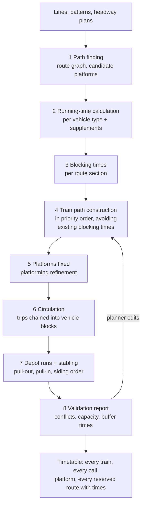

# ADR-0032: Railway operations management: rail lines from stations, conflict-free timetables on blocking times, and a traffic management layer that reschedules

- Status: Proposed (design for product owner review, 2026-10-28)
- Date: 2026-10-28
- Deciders: product owner, architecture
- Related: FR-NET-10, FR-NET-11, FR-SIM-02, FR-SIM-04, FR-SIM-07, FR-SIM-09, FR-TT-01..06, NFR-PERF-03, NFR-ACC-01/02, ADR-0006 (rail kernel), ADR-0007 (co-simulation), ADR-0028 (persistence), ADR-0029 (street lines), ADR-0030 (railway design tool), [07 §4, §9, §11](../architecture/07-simulation.md), [spike S2](../spikes/s2-rail-kernel-performance.md)

## Context

The product owner asked for a railway operations system, not only a router (2026-10-28):

1. The planner creates a **rail service line by picking stations or platforms**. Stations with the same name are **one station in two (or more) parts**.
2. The system produces the **schedule of every train**: arrival and departure at every station, the **platform** (when the planner did not fix one), and when each train **leaves the depot and returns to it**.
3. It **reserves and blocks track sections and platforms**, makes sure every train runs at the **right speed on every section**, keeps its **distance** to other trains and is **where it should be at every second**, and that **no collision or overlap ever happens**.
4. It is **dynamic**: when a signal, switch or vehicle fails, it adjusts the plan.

ADR-0006 already decided a custom Rust kernel with fixed-block interlocking, and spike S2 showed 2,000 trains a day at about 13,000× real time with exclusive section reservation. 07 §4 and §11 sketch dispatching, platform assignment, rerouting and a blocking-time conflict check, but not how lines are authored, how the timetable is constructed, how depots are worked, or how disruptions are handled. ADR-0030 and the railway design tool (`crates/rail-design`, in progress) own the track, station, switch and signal geometry.

Railway operations is a mature field with standard methods. We use them rather than inventing our own:

| Need | Established method | Reference |
|------|--------------------|-----------|
| Minimum running time | Running-time calculation by numerical integration of tractive effort, resistance (Davis), gradient and curves; braking curves | Brünger & Dahlhaus, "Running time estimation", in Hansen & Pachl (eds.), *Railway Timetabling & Operations*, 2nd ed., 2014 |
| Track occupation and headway | **Blocking time theory** (blocking time stairway): each block or route section is blocked from route setting to release | Pachl, *Railway Operation and Control*; UIC Code 406 (capacity), 2nd ed., 2013 |
| Timetable supplements | Running-time supplements and buffer times | UIC Code 451-1 |
| Clock-face timetables | Periodic Event Scheduling Problem (**PESP**) | Serafini & Ukovich, *SIAM J. Discrete Math.* 2(4), 1989; Liebchen, PhD thesis, TU Berlin, 2006 |
| Inserting a train into an existing plan | Space-time path search around existing blocking times (OSRD's STDCM, "short term digital capacity management") | OSRD documentation, *STDCM* |
| Platform assignment | **Train platforming problem**: conflict graph and assignment | Caprara, Galli & Toth, *Transportation Science* 45(2), 2011 |
| Rolling stock circulation | Trip chaining as an assignment / minimum-cost flow problem | Hansen & Pachl 2014; Ahuja, Magnanti & Orlin, *Network Flows*, 1993 |
| Depot stabling | Train unit shunting and track assignment on stabling sidings (LIFO on dead-end tracks) | Lentink, PhD thesis, Erasmus Univ. Rotterdam, 2006 |
| Interlocking | Routes from signal to signal, overlaps, flank protection, approach locking, sectional release | Pachl; DB Ril 819 (already cited for overlaps in the assumption library) |
| Moving block | ETCS Level 2 / CBTC movement authority to the rear of the train ahead with braking curves | IEEE 1474.1 (CBTC); ERA *ETCS Subset-026* |
| Real-time rescheduling | **Alternative graph** (job shop with blocking) for retiming and reordering; rerouting with K shortest paths | Mascis & Pacciarelli, *EJOR* 143(3), 2002; D'Ariano, Pacciarelli & Pranzo, *EJOR* 183(2), 2007 (ROMA); Yen, *Management Science* 17(11), 1971 |

## Decision

### 1. Shared infrastructure model, compiled for operations

- `crates/rail-design` (ADR-0030) stays the owner of geometry, stations, switches and signal placement. It exports a **topology** with stable ids: track sections with speed, gradient and curve profiles; switch nodes with legs, diverging speeds and fouling points; platform edges with chainage, length, height and side; signals with position, direction and type; the signalling system per area (line of sight, fixed block, ETCS L2, CBTC); storage tracks grouped into depots. A JSON Schema in `contracts/` describes the export so both sides test against the same file.
- A new crate `crates/rail-model` **compiles** the export into the operations model the kernel and the planner share:
  - **Train detection sections (TDS)** split at signals and fouling points (if the design gives no detection boundaries).
  - The **route table**: every route from a main signal to the next main signal in the same direction, with its TDS, the required switch positions, the **overlap** beyond the exit signal (length from `signalling.overlap_*` by approach speed) and **flank protection** elements (switches held away, or TDS that must be clear). Conflicting routes are computed once (shared TDS, shared switch in the other position, overlapping overlaps).
  - **Stopping points** per platform edge and train length (head stop marker so the whole train is on the platform, from the platform end facing the direction of travel).
  - **Stations and station groups**: stations with the same normalised name (case, accents and spacing ignored, as the planner sees it) form one `StationGroup`; each station is a **part**. Walking time between parts uses the station grouping rule of 06 §9.3. The planner can split or merge groups by hand.
- Nothing in the operations code re-derives geometry; if the design changes, the model is recompiled and dependent timetables are marked stale (as in 09 §1.5).

### 2. Rail line authoring: pick stations or platforms

A rail line is an ordered list of **calls** in a **pattern** (07 §11 terms; `svc.line`, `svc.pattern`, `svc.pattern_stop`):

| Pick | Meaning |
|------|---------|
| A **station group** | The train calls at this station; any platform in any part may be used. The planner picks this when they don't care. |
| A **station** (one part) | Any platform of this part. |
| A **platform edge** | This platform is fixed. The planner can also give a preferred platform plus allowed alternatives. |
| **Pass** | The train runs through without stopping (the path still has to use the station's tracks). |

Per call the planner can give a minimum dwell (default `mode.dwell_s`), a timing point flag (holding, FR-TT-02) and arrival/departure windows. The ends of the line are **terminals**, each with a **turn-back mode**: reverse in the platform (the default for multiple units; the driver changes ends, minimum turn-back time from the assumption library), via a turn-back siding beyond the station, or a loop. A line has a **headway plan** per time period and day type (for example every 10 minutes 06:00–09:00), or **explicit departure times**, and a home **depot**. A line may be **clock-face** (same minutes every hour) or not. Both directions are generated from one pattern, with per-direction exceptions allowed.

### 3. Planning pipeline (before a run): conflict-free by construction

1. **Path finding.** On the **route graph** (nodes are signals, edges are routes; `petgraph`), A* / Dijkstra finds the path between consecutive calls, for each candidate platform at the calls. Yen's K shortest paths (`pathfinding`, K = 5 default, as in 07 §4.4) gives alternatives. Paths are filtered by train compatibility: length against platform and siding length, electrification, gauge.
2. **Running-time calculation** with the kernel's own dynamics (`rail-dynamics`, the same code the simulation runs, so the plan and the simulation agree): tractive effort from the vehicle catalogue, Davis resistance, gradient, curve resistance, speed profile, braking curves. Result: minimum running time per section, a speed profile and the time at every metre. A **running-time supplement** (`timetable.recovery_share`, UIC 451-1 style) is added. Accuracy is checked against OSRD on reference networks (NFR-ACC-01).
3. **Blocking times.** For every route a train uses, the blocking time is: route setting time (switch throw time, from the catalogue) + sight and reaction time + approach time (from the point the train must see a proceed aspect to stop at the entry signal otherwise) + running time through the route + clearing time (train length + overlap) + release time. Under moving block the "sections" are short virtual blocks along the path and the separation is the braking distance plus `sim.rail_min_following_distance_m`. Platforms are resources too: a platform edge is blocked from the train's route setting into it until its departure route is released.
4. **Train path construction.** Trains are inserted one at a time, in priority order (class priority from 07 §4.4, then the planner's order, then departure time; the order is deterministic). Each train is placed with a **space-time search** that avoids all blocking times already placed plus a **minimum buffer time** (new parameter `timetable.min_buffer_s`; source to be cited from UIC 406 or national practice). The search may shift the departure inside the allowed window, extend a dwell, choose another candidate platform or an alternative route. If no conflict-free path exists, the train is reported with the blocking train and section, never silently dropped. For clock-face lines an optional **PESP** step first fixes the periodic departure minutes of all lines at shared sections; the insertion then works inside those minutes.
5. **Platforms.** Calls with a free choice get the platform the search chose; a refinement pass (train platforming problem) evens out platform use and prefers cross-platform transfers between lines the planner marks as connecting. Platforms the planner fixed are never changed.
6. **Circulation.** Trips are chained into **vehicle blocks**: at each terminal, an arriving trip can continue as a departing trip if the turn-back time fits (and the turn-back move is itself a conflict-free path). This is an assignment / minimum-cost flow problem (cost = vehicles used, then empty kilometres, then waiting); the Hungarian algorithm from `pathfinding` (`kuhn_munkres`) solves the bipartite form. Fleet = peak blocks × (1 + reserve share), as in 07 §11.
7. **Depot runs.** Every block starts with a **pull-out** from a storage track of its depot to the first call and ends with a **pull-in** from the last call. Both are planned as ordinary trains (paths, running times, blocking times), timed backward from the first departure and forward from the last arrival, so they never conflict with service trains. **Stabling** assigns each train a storage track with enough usable length (07 §4.6) and respects the order on dead-end sidings: the train that leaves first must not be behind one that leaves later. Mid-day returns between peaks are added when the block has a long gap and the depot is near (07 §11, ADR-0029 §10 for buses).
8. **Validation** reports: remaining conflicts (none if construction succeeded), buffer times below target, platform too short, turn-back too short, depot capacity, energy (later). Every value the planner edits re-runs only the affected trains (they are removed and re-inserted), with a diff before saving.

The output is a **train path** per train: each call with arrival, departure and platform, plus every route it will reserve with its blocking interval. This is the plan the simulation executes, and the basis for the time-distance graph (blocking time stairways) and platform occupancy charts in the UI.

### 4. Execution in the simulation: safety by interlocking, punctuality by driver model

The kernel (`rail-interlocking`, `rail-sim`; 07 §4.3) grows from the S2 prototype:

- **Interlocking.** Routes from the route table. A route is set only if all its TDS and overlap are free and not locked by another route, its switches can move (or are already right) and are not locked elsewhere, and its flank protection is available. Switches throw (with throw time), then lock; the route locks **atomically**; the signal clears. **Approach locking** stops a route being cancelled in front of a train that can no longer stop. **Sectional release** frees TDS as the tail clears them; the overlap is released once the train has stopped at the exit signal, after a time-out.
- **Train protection.** Each train has a **movement authority** to the end of its last set route (fixed block) or to the rear of the train ahead minus the safety margin (moving block, CBTC / ETCS L2 for the modes that use them), and a **permitted speed** at every point (line speed, curve speed, switch speed, temporary restrictions, braking curve to the end of authority). The driver model never exceeds the permitted speed; an overspeed triggers emergency braking and a run warning (a bug if it happens in normal operation).
- **Driver model (ATO style).** The train runs to the plan: it departs on time, follows the planned speed profile when on time, uses the running-time supplement as coasting when early, and runs at maximum performance when late. Early trains hold at timing points (FR-TT-02). Position is integrated with a step of at most 1 s (smaller near targets), so every train has an exact position and speed at every second (07 §2).
- **Automatic route setting (ARS).** Routes are requested from the plan: when the train approaches, in the **planned order** at each junction and platform (the train sequence from §3). A train never gets a route the plan gives to another train first, unless the traffic management layer (§5) changed the order. Before a train enters a single-track section or a turn-back, the dispatcher checks it can also leave (reservation look-ahead), so planned operation cannot deadlock.
- **Event-driven** route requests (wake on release), replacing the S2 prototype's per-step polling.

**Safety invariants**, checked by property-based tests (`proptest`) and by assertions in every run:

1. Every TDS under a train is reserved by that train; no TDS is reserved by two trains.
2. No train is beyond its movement authority; no train passes a signal at danger in normal operation.
3. A switch under a train or in a locked route never moves.
4. Two routes that conflict are never locked at the same time.
5. No train exceeds its permitted speed by more than the supervision tolerance.

A violated invariant stops the run with a state dump: it is a bug, never a result.

### 5. Traffic management: dynamic rescheduling

A **traffic management layer** (`rail-dispatch`) watches the running plan and repairs it:

- **Prediction.** Every event that changes the plan (a delay above `recording.late_threshold_s`, a failure, a repair) re-predicts the blocking times of all trains in a **horizon** (new parameter, default 60 minutes) from their current state.
- **Conflict detection.** Overlapping predicted blocking times are conflicts.
- **Resolution**, in this order of preference (configurable, deterministic):
  1. **Retiming**: hold a train at a station to keep the planned order (delay propagation only).
  2. **Reordering**: change the order at a junction or platform when it reduces total weighted delay (class priority and passenger load as weights). This is the alternative graph model: for each pair of trains competing for a section, choose which goes first. A greedy rule (first come, first served with priorities) is the baseline; a branch-and-bound or local search over the alternative graph refines it within a time budget.
  3. **Replatforming**: another compatible platform in the same station or station part (announced to the passenger engine as a platform change).
  4. **Rerouting**: another path from Yen's K shortest that avoids the blocked element.
  5. **Short-turning** at an intermediate station with a turn-back, and **cancelling** parts of trips when the line cannot be run through. The circulation is repaired so the vehicle reaches its next trip or the depot.
  6. **Replacement vehicles**: a reserve train is pulled out of the depot to take over a failed vehicle's block.

  Every decision is a run event with the reason, the alternatives considered and the delay estimate.
- **Failures** (07 §9, seeded MTBF/MTTR per asset class or scheduled by the planner):

| Failure | Effect in the kernel | Operations response |
|---------|----------------------|---------------------|
| **Signal failure** | Signal stays at danger | Train stops, then passes on **written order** at caution speed (`signalling.caution_speed_kmh`, new) by line of sight to the next signal; blocking times on that section grow; TMS retimes and may reroute |
| **Switch failure** | Switch stuck in one position or unusable; routes needing the other position are unavailable | Rerouting, replatforming or short-turning; a stuck switch can still be used in its locked position |
| **Track circuit / axle counter failure** | TDS shows occupied | Like a signal failure on the routes through it |
| **Vehicle failure** | Train stops (or loses power and runs at reduced speed), keeps its TDS | Following trains are held; a rescue (assisting train or locomotive from the depot) or recovery to the depot; the block is covered by a reserve vehicle; passengers handled by the passenger engine |
| **Power section loss** | Electric trains in it coast to a stand | Trains outside are held; diesel or battery trains continue |
| **Temporary speed restriction** | Lower permitted speed on a range | Blocking times re-predicted; retiming |

  When the failure is repaired, the TMS steers trains back to the plan (recovering delay with the supplements and buffers) and returns diverted vehicles to their blocks.

### 6. Crates and where things run

| Crate | Content |
|-------|---------|
| `rail-model` | Topology import, TDS, route table, station groups, stopping points |
| `rail-dynamics` | Running-time calculation and braking curves (shared by planner and kernel) |
| `rail-plan` | Path finding, blocking times, train path construction, PESP, platforming, circulation, depot runs and stabling, validation |
| `rail-interlocking` | Route setting, locking, release, train protection |
| `rail-dispatch` | ARS, traffic management and rescheduling |
| `rail-sim` | The kernel loop (from the S2 prototype), failures, recorder output |

All are Rust, deterministic (no wall clock, seeded RNG, stable iteration order, NFR-ACC-02), with Python bindings through `mobsim-py` for the worker and a WebAssembly build of `rail-plan` for instant feedback in the line editor when that proves useful (as ADR-0031 did for street routing). Only `petgraph`, `pathfinding` and `proptest` are needed as new dependencies; no external solver is required for the first version. If optimal platforming or PESP needs a solver later, OR-Tools CP-SAT (Apache-2.0, already usable from the Python worker) is the candidate, behind the same interface.

### 7. Order of work after approval

1. `rail-model`: topology contract with the design tool, TDS and route table generation, station groups. Tests on hand-made stations (two-platform terminal, through station with crossovers, junction).
2. `rail-dynamics` + blocking times + a **timetable conflict checker** (FR-TT-06) with a blocking time stairway output.
3. `rail-plan`: line authoring model, headway plans, train path construction, platforms, circulation, depot runs and stabling. Example project: a metro line with a depot and a regional line sharing a junction.
4. Kernel: switches, overlaps, flank protection, approach locking, moving block, driver model, ARS; the five safety invariants as property tests.
5. `rail-dispatch`: failures and rescheduling, demonstrated on the example project (signal failure, switch failure, failed train with rescue).
6. UI: the rail line tool (pick stations or platforms on the map), timetable tables, time-distance graph, platform occupancy chart, depot plan, and run events in the simulation view.

## Alternatives considered

| Option | Why not |
|--------|---------|
| Let trains find their way at run time (dispatcher only, no conflict-free plan) | Gives no timetable to publish, no platform plan and no depot plan; conflicts are found only by running, and delays look like capacity problems. Real infrastructure managers plan on blocking times first. |
| Embed OSRD (STDCM, conflict detection, running times) | Multi-service JVM platform, conflicts with ADR-0003 and ADR-0006. We follow its methods and use it as the accuracy oracle. |
| Solve the whole timetable as one MILP / CP model | Best plans on small cases, but run time grows quickly, results are harder to explain and to edit train by train, and it adds a solver dependency on day one. Kept as an optional refinement step behind the same interface. |
| Headway check only (minimum seconds between trains, `mode.min_headway_s`) | Ignores junctions, platform tracks, turn-backs and different train speeds; blocking times include them all. The headway parameter stays as a quick capacity estimate. |
| Separate timetable and simulation dynamics | The plan and the simulation would disagree; using one `rail-dynamics` crate keeps the planned speed profile and the simulated one the same. |

## Consequences

- The planner gets what was asked: lines from stations or platforms, a full timetable with platforms and depot moves, conflict-free by construction, and a simulation that follows it second by second and repairs it on failures.
- "No collision or overlap" rests on two layers: the plan is conflict-free on blocking times, and the interlocking and train protection enforce exclusivity at run time even when the plan is broken by failures.
- The route table and blocking times depend on signals and switch data from the design tool, so the topology contract with `rail-design` is the first deliverable and is shared with that work.
- New parameters in the assumption library and Project Preferences: `timetable.min_buffer_s`, `timetable.turnback_min_s` per mode, `signalling.caution_speed_kmh`, `signalling.sight_reaction_s`, `signalling.route_setting_s`, `operations.tms_horizon_min`, failure MTBF/MTTR per asset class. Each needs a cited or documented source before merge.
- The rail kernel stays the largest custom component (ADR-0006). Spike S2's headroom (≈ 13,000× against a 50× target) pays for the richer interlocking and the TMS; NFR-PERF-03 is re-measured after step 4.

## Questions for the product owner

1. **Clock-face timetables:** should lines default to clock-face (same minutes every hour) or to the headway plan alone? This decides whether PESP is in the first version.
2. **Automatic short-turns and cancellations:** may the traffic management layer short-turn and cancel trains on its own under disruption, or should it stop at retiming, reordering, replatforming and rerouting and report the rest?
3. **Turn-back default:** reverse in the platform (typical for metro and multiple units) as the default for all rail modes, with sidings and loops as options?
