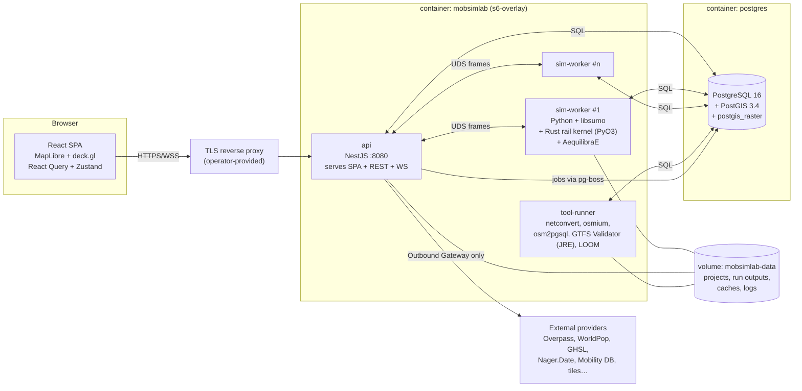
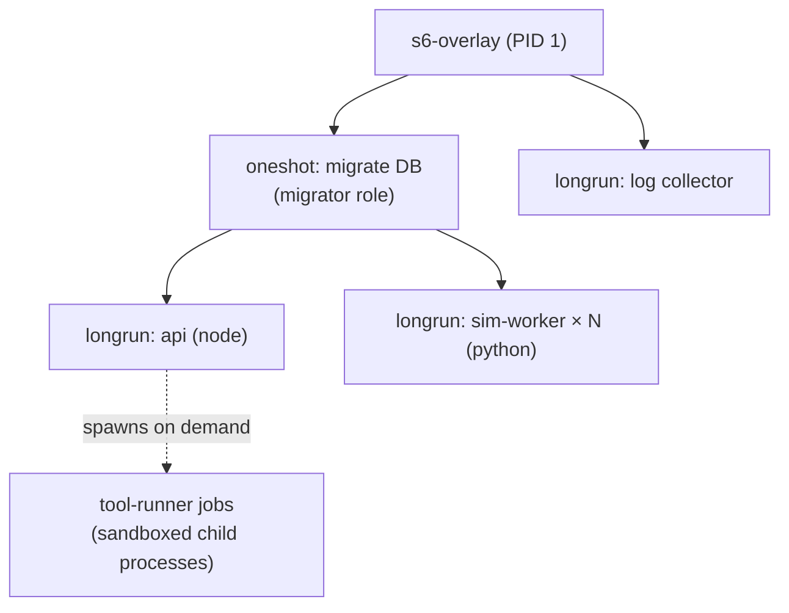

# 03 — Technical architecture

## 1. Architectural style

MobSimLab is a **modular monolith** for the API plus **separate compute processes** for simulation and modelling. A modular monolith keeps deployment simple (one image) while module boundaries are enforced in code (NestJS modules with explicit public interfaces, lint rules forbidding cross-module imports of internals). Compute processes are separate because they have different runtime needs (CPU-bound, native libraries, long-running) and must not affect the API's availability (see [C-01](00-challenged-assumptions.md#c-01--one-application-container-for-frontend-backend-gis-routing-sumo-and-rail-simulation--high--decision-needed), ADR-0003, ADR-0004).

Communication rules:

- **UI ↔ API:** HTTPS JSON (REST, OpenAPI 3.1), plus one WebSocket per client for live simulation frames, presence and notifications.
- **API ↔ workers:** jobs in PostgreSQL via `pg-boss` (durable, retried, visible). Live frames over a local Unix domain socket (MessagePack). Results written to PostgreSQL and the project volume.
- **Workers ↔ PostgreSQL:** direct, with a dedicated database role that can only read inputs and write results for the run it owns.
- **Anything ↔ the internet:** only through the **Outbound Gateway** module in the API (ADR-0017). Workers have no outbound internet access.

## 2. Runtime view



## 3. Technology stack

| Layer | Choice | Licence | Why |
|-------|--------|---------|-----|
| UI framework | React 18, TypeScript 5, Vite | MIT | Brief |
| Map | MapLibre GL JS 4 | BSD-3-Clause | Brief; open fork of Mapbox GL |
| Moving objects / large overlays | deck.gl 9 (MapLibre interleaved mode) | MIT | GPU instancing for thousands of animated vehicles; MapLibre symbol layers do not scale to that (ADR-0024) |
| Server state | TanStack React Query 5 | MIT | Brief |
| Client state | Zustand | MIT | Brief |
| Styling / components | Tailwind CSS, shadcn/ui (Radix primitives) | MIT | Brief |
| Geometry in browser | Turf.js | MIT | Mature, small functions |
| Schematic editor | SVG via React + d3-shape | ISC | Curves and drag, no canvas framework needed |
| Forms / validation | react-hook-form + Zod | MIT | Same Zod schemas generate API contracts |
| Frontend logs | Pino (browser build) | MIT | Brief |
| i18n | i18next | MIT | NFR-I18N-01 |
| API | NestJS 10 on Node.js 22 LTS | MIT | Brief |
| ORM / SQL | Kysely (typed SQL builder) + raw SQL for PostGIS | MIT | Full control over spatial SQL; no ORM magic over PostGIS (ADR-0009) |
| DB migrations | `node-pg-migrate` (SQL files) | MIT | Plain SQL migrations reviewed like code |
| Job queue | pg-boss | MIT | Queue in PostgreSQL; no extra service (ADR-0023) |
| Auth | `openid-client` | MIT | Certified OIDC RP library |
| Backend logs | Winston | MIT | Brief |
| Validation | Zod (API), JSON Schema 2020-12 (files), Ajv | MIT | One schema source |
| Security middleware | helmet, `@nestjs/throttler`, csrf-csrf | MIT | CSP, headers, rate limiting, CSRF |
| Sim worker | Python 3.12 | PSF | libsumo, AequilibraE, SUMO tools |
| Road simulation | Eclipse SUMO 1.2x via libsumo | EPL-2.0 (secondary GPL-2.0+) | Brief (ADR-0005) |
| Rail kernel | Rust (stable), PyO3, `petgraph`, `pathfinding`, `rayon` | MIT/Apache-2.0 | Performance and safety (ADR-0006) |
| Demand model | AequilibraE | see compliance report | Mature four-step toolkit (ADR-0019) |
| Numeric | NumPy, SciPy, pandas, PyArrow | BSD / Apache-2.0 | Standard |
| Results files | Apache Arrow IPC / Parquet | Apache-2.0 | Columnar, compressed, readable by everyone (ADR-0014) |
| GIS tools | GDAL/OGR, osmium-tool, osm2pgsql | MIT / GPL-3.0 / GPL-2.0+ | Invoked as separate programs |
| GTFS validation | MobilityData GTFS Validator | Apache-2.0 | Brief |
| Schematic layout | LOOM (octi, topo) | GPL-3.0 | Mature octilinear transit map layout (ADR-0025) |
| Database | PostgreSQL 16 + PostGIS 3.4 | PostgreSQL / GPL-2.0+ | Brief |
| Process supervisor | s6-overlay | ISC | Multiple processes in one container (ADR-0003) |
| Contracts | JSON Schema → `json-schema-to-typescript`, `datamodel-code-generator`, `typify` | MIT/Apache | One source for TS, Python, Rust types |

## 4. Backend module structure (NestJS)

Each module owns its tables (schema) and exposes a service interface. Other modules may only call that interface.

| Module | Responsibility |
|--------|----------------|
| `core` | Config, global ID, metadata envelope, error model, i18n |
| `auth` | OIDC login, sessions, CSRF, first-owner setup mode |
| `iam` | Users, groups, instance roles, project roles, permission checks (policy engine) |
| `audit` | Append-only hash-chained audit writer and reader |
| `logging` | Winston setup, sinks, frontend log ingestion, redaction |
| `projects` | Projects, visibility, sharing, preferences, scenarios |
| `sources` | Source registry, attribution, licences page data |
| `assumptions` | Assumption library, resolution, overrides, sensitivity registry |
| `providers` | Provider configs, encrypted credentials, health checks |
| `gateway` | Outbound HTTP: allowlist, SSRF guard, throttle, retry, cache, tile proxy |
| `gis` | OSM import orchestration, population, DEM, layer catalogue, vector tiles (ST_AsMVT) |
| `network` | Unified graph, edges/nodes, track alignment, validations |
| `stations` | Stations, platforms, naming, grouping, platform validator |
| `transit` | Lines, routes, patterns, stops, GTFS import |
| `vehicles` | Catalogue loading, vehicle types, custom vehicles, fleet |
| `depots` | Depot geometry, slot generation, capacity checks |
| `timetables` | Timetable generation workflow, conflict checks, exports |
| `simulation` | Run definitions, scheduling, live frame relay, results index |
| `demand` | Demand model configuration and run orchestration |
| `costing` | Cost model, appraisal, externalities, sensitivity |
| `schematics` | Diagram generation (via LOOM) and editable diagram storage |
| `files` | Project import/export (`.mslab`), uploads, virus/size checks |
| `collab` | Presence, comments, notifications, optimistic locking helpers |
| `admin` | Instance settings, user admin, auto-registration toggle |

Python `sim-worker` packages: `mobsim_worker.jobs`, `.road` (SUMO adapter), `.rail` (bindings to the Rust crate), `.cosim`, `.demand`, `.timetable`, `.results`, `.kinematics`.

Rust workspace crates: `rail-model` (types), `rail-dynamics` (running-time calculation), `rail-interlocking` (routes, locking, signals), `rail-dispatch` (dispatching, platform assignment, rerouting), `rail-sim` (event loop), `kinematics` (axle/bogie/body pose derivation for all vehicles), `mobsim-py` (PyO3 bindings).

## 5. Frontend structure

Feature-sliced folders: `app/` (shell, routing, providers), `features/<feature>/` (map, layers, network-editor, stations, vehicles, depots, timetable, simulation-view, demand, costing, schematics, assumptions, sources, admin, project-files), `entities/` (typed API hooks generated from OpenAPI), `shared/` (ui kit from shadcn, map utilities, logging, i18n).

The map is the root view. Panels are dockable side sheets and a bottom drawer (timetables, charts). The simulation view swaps editing tools for playback controls and makes all stores read-only.

## 6. Logging

| Level | Numeric | Use |
|-------|---------|-----|
| TRACE | 10 | Very detailed flow, off in production |
| DEBUG | 20 | Diagnostic detail |
| INFO | 30 | Normal significant events |
| WARN | 40 | Unexpected but handled |
| ERROR | 50 | Operation failed |
| CRITICAL | 60 | Service-level failure, needs operator |
| AUDIT | — | Not a severity. Routed to the audit module (ADR-0012) |

- **Backend (Winston):** JSON lines. Sinks: console (all levels ≥ configured), rotating file in `/data/logs` (≥ configured), PostgreSQL `logs.entry` (WARN+ only, 30-day retention via partition drop). Every entry carries `requestId`, `userId` (pseudonymous), `projectId`, `runId`, `module`.
- **Frontend (Pino browser):** buffered, sent every 10 s or on ERROR to `POST /api/logs` (authenticated, rate-limited, size-capped, schema-validated). Stored like backend logs with `origin=frontend`.
- **Workers (Python `structlog`, Rust `tracing`):** JSON to stdout; s6 collects into the same file sink; WARN+ forwarded via the API.
- **Redaction:** a shared deny-list (tokens, passwords, `Authorization`, cookies, credential fields) applied in every sink; tests assert redaction.

## 7. Deployment architecture

### 7.1 Compose layout (planned, not yet code)

```yaml
# compose.yaml (sketch for review)
services:
  mobsimlab:
    image: ghcr.io/homlo-bike/mobsimlab:${MOBSIMLAB_VERSION}
    container_name: mobsimlab
    ports: ["8080:8080"]
    environment:
      MOBSIMLAB_PUBLIC_URL: ${MOBSIMLAB_PUBLIC_URL}
      MOBSIMLAB_SIM_WORKERS: "2"
      MOBSIMLAB_DB_HOST: postgres
    secrets: [db_app_password, db_worker_password, master_key, session_secret]
    volumes: ["mobsimlab-data:/data"]
    depends_on: { postgres: { condition: service_healthy } }
    read_only: true
    tmpfs: ["/tmp"]
    cap_drop: [ALL]
    security_opt: ["no-new-privileges:true"]
    user: "10001:10001"
    healthcheck: { test: ["CMD", "/app/bin/healthcheck"], interval: 30s }
    deploy: { resources: { limits: { cpus: "6", memory: 24g } } }

  postgres:
    image: postgis/postgis:16-3.4
    container_name: postgres
    environment:
      POSTGRES_PASSWORD_FILE: /run/secrets/db_superuser_password
    secrets: [db_superuser_password, db_app_password, db_worker_password]
    volumes: ["pgdata:/var/lib/postgresql/data", "./db/init:/docker-entrypoint-initdb.d:ro"]
    # no host port published
    healthcheck: { test: ["CMD-SHELL", "pg_isready -U postgres"], interval: 10s }

secrets:   # files created by `scripts/init-secrets` with random values
  db_superuser_password: { file: ./secrets/db_superuser_password }
  db_app_password:       { file: ./secrets/db_app_password }
  db_worker_password:    { file: ./secrets/db_worker_password }
  master_key:            { file: ./secrets/master_key }
  session_secret:        { file: ./secrets/session_secret }

volumes: { pgdata: {}, mobsimlab-data: {} }
```

Rules:
- The app **refuses to start** if a secret is missing, too short, or equals a known example value. There are no default passwords.
- PostgreSQL is not published on the host. Three database roles: `mobsimlab_app` (API), `mobsimlab_worker` (restricted), `mobsimlab_migrator` (DDL, used only at start-up for migrations).
- Image is multi-stage: build stages for the SPA, NestJS, Rust wheel, LOOM; runtime on Debian slim with SUMO from the official Eclipse SUMO packages, Python venv, jlink JRE. Target size ≤ 2 GB (SUMO + JRE + GDAL dominate).
- Images are signed (cosign) and published with a CycloneDX SBOM.

### 7.2 Process model inside `mobsimlab`



### 7.3 Environments

| Env | How |
|-----|-----|
| Development | `compose.dev.yaml` override: hot reload, Keycloak dev realm container, Mailpit, seeded test data |
| CI | Same image; integration tests against ephemeral Postgres; Playwright E2E |
| Production (self-hosted) | `compose.yaml` + operator's TLS proxy and OIDC provider |
| Demo | Public read-only instance with example projects, auto-registration off |

### 7.4 Backup and upgrade

- `scripts/backup` runs `pg_dump -Fc` and archives `/data/projects`. Restore is tested in CI.
- Upgrades: pull new image, restart. Migrations run once in the `migrate` step under an advisory lock. Project file migrations run lazily on open.
