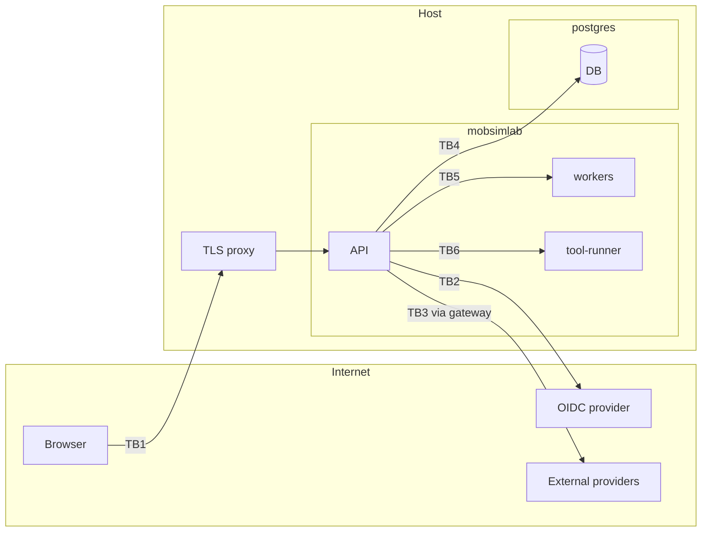
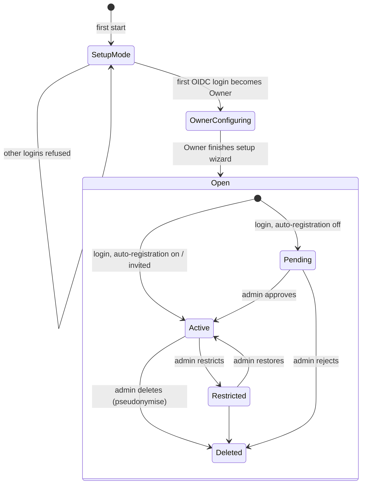

# 05 — Security architecture and user management

The full STRIDE threat model is in [../security/threat-model.md](../security/threat-model.md). This chapter describes the controls.

## 1. Security goals

1. No unauthorised access to private projects, credentials or audit data.
2. No compromise of the host through uploads, imports, external providers or simulation inputs.
3. Integrity of results: a published result can be traced to its inputs, version and seed, and the audit trail shows who changed what.
4. Secure by default: a fresh install has no default credentials, no open registration, and no exposed database.

Target standard: **OWASP ASVS 4.0.3 Level 2** (a checklist file will track each control, owner and test). OWASP Top 10 (2021) mapping is in the threat model.

## 2. Trust boundaries

TB1 user input · TB2 identity assertions · TB3 untrusted remote data · TB4 data store · TB5 compute jobs (inputs are user-controlled) · TB6 native tools parsing untrusted files.

## 3. Controls by area

### 3.1 Authentication (OIDC only)

- Authorization Code flow with **PKCE**, `state` and `nonce`; ID token signature, `iss`, `aud`, `exp`, `iat`, `nonce` validated by `openid-client`.
- Multiple providers configurable by admins; each has an issuer allowlist.
- No local passwords. Break-glass access (lost Owner account) is an operator command run inside the container (`mobsimlab admin reset-owner`), which puts the instance back into setup mode; it is audited.
- **First-owner setup mode** (ADR-0015): the instance is designed for self-hosting on a private network, not exposure to the internet. On first start it is in **setup mode**. The first user who completes an OIDC login becomes **Owner** (in one transaction with a row lock, so two simultaneous logins cannot both win). While in setup mode, every other login is refused with "This instance is being set up". The Owner completes the **setup wizard**: instance name and public URL, OIDC providers and group-to-role mappings, auto-registration policy and default role, external providers and credentials, basemaps, units and locale, default Project Preferences. Only when the Owner presses **Finish setup** do other users get access. Optional: `MOBSIMLAB_BOOTSTRAP_OWNER_EMAIL`/`_SUBJECT` restricts who may become the first Owner, for operators whose IdP is shared with other people.
- **Bootstrap provider:** the first provider comes from the environment (`MOBSIMLAB_OIDC_ISSUER`, `MOBSIMLAB_OIDC_CLIENT_ID`, optional `oidc_client_secret` secret), because someone must be able to sign in before the wizard exists. Further providers are added in the wizard. The callback's `state` is single-use, expires after 10 minutes and is bound to the browser by a short-lived cookie, which prevents login CSRF.
- Sessions: server-side session rows (only a SHA-256 hash of the cookie value is stored); cookie `__Host-msl_session`, `HttpOnly`, `Secure`, `SameSite=Lax`, 12 h idle / 7 d absolute timeout, rotated on login and privilege change. Logout revokes server-side and calls the IdP end-session endpoint where supported.
- Account matching is by `(issuer, subject)`, never by email alone (prevents account takeover through a second IdP with the same email).

### 3.2 Authorization

Two layers:

**Instance roles**

| Role | Can |
|------|-----|
| Owner | Everything, including transferring ownership and managing admins. At least one owner must always exist. |
| Admin | Manage users, groups, providers, auto-registration, all projects (with audit) |
| User | Create projects; access projects shared with them |
| Viewer | Read projects shared with them and public projects; cannot create projects |
| Restricted | Log in, see a notice; no project access. Used to suspend without deleting |

**Project roles:** Project Owner, Editor, Commenter, Viewer. Effective permission = intersection of instance role ceiling and project role (a Viewer at instance level who is "Editor" on a project is still read-only).

**Policy engine:** a single `PermissionService.can(actor, action, resource)` in `iam`, backed by a declarative policy table (action × role). Every controller method carries a `@Requires(action)` decorator; a CI test fails if any route lacks one. RLS in PostgreSQL is a second line (see 04 §3.3).

**Group mapping:** admins map IdP group claim values to instance roles and to project memberships. On every login, mapped roles are recomputed; a **manual override** flag on the user pins a role and is shown in the admin UI. When several mappings match, the highest role wins, except that a match to Restricted always wins (so a suspension group cannot be outvoted). A mapping can never grant Owner, and only an Owner may create or remove a mapping to Admin. A role set by an admin is pinned by default. Owners are never changed by mappings.

**Who manages whom:** only an Owner may create, change or delete Owners and Admins; Admins manage User, Viewer and Restricted accounts. Nobody changes their own account through the admin API, and the last active Owner cannot be demoted or deleted (checked under a lock on the instance row). Deleting a user removes e-mail, name and group claims and ends all sessions; the row and the (issuer, subject) pair remain so audit records keep their actor and the account cannot silently register again.

**Auto-registration:** off by default. When on, new users get the configured default role (default Viewer), or their mapped role, and optionally must belong to an allowed IdP group or have a provider-verified email in an allowed domain; others wait for approval.

### 3.3 Input validation and output encoding

- Every API input validated by Zod schemas generated from the shared contract; unknown fields rejected.
- Geometry inputs: validity (`ST_IsValid`), vertex count limits, coordinate bounds, area limits per project.
- File uploads: size limits per type, magic-number sniffing, extension allowlist (GeoTIFF, GeoJSON, CSV, GTFS zip, `.mslab`, vehicle JSON, PBF). Zip bomb protection: limits on entry count, total uncompressed size, compression ratio, and path traversal (`..`, absolute paths, symlinks rejected).
- Uploaded files are parsed in **tool-runner** child processes with resource limits (CPU time, memory, no network, read-only filesystem except a scratch dir, seccomp default profile).
- Output: React escapes by default; `dangerouslySetInnerHTML` banned by lint. User Markdown (descriptions, comments) rendered with a strict sanitiser (DOMPurify, no raw HTML). Exports (CSV) escape formula prefixes (`=`, `+`, `-`, `@`) to prevent CSV injection.
- SQL: parameterised queries only (Kysely); dynamic identifiers only from allowlists.

### 3.4 Browser security

- CSP: `default-src 'self'; script-src 'self'; style-src 'self' 'unsafe-inline'` (Tailwind/MapLibre need inline styles; no inline scripts) `; img-src 'self' data: blob:; worker-src 'self' blob:; connect-src 'self'; frame-ancestors 'none'; base-uri 'none'; form-action 'self'`. All map tiles go through the backend tile proxy or allowlisted origins added to `img-src`/`connect-src` by admin config.
- CSRF: a synchroniser token derived from the session (HMAC with `session_secret`), sent in `X-CSRF-Token` on all state-changing requests, plus `SameSite=Lax` and an `Origin` (or `Referer`) check that refuses state-changing requests from other origins or with neither header.
- Headers via helmet: HSTS (when HTTPS), `X-Content-Type-Options`, `Referrer-Policy: strict-origin-when-cross-origin`, `Permissions-Policy` minimal, `Cross-Origin-Opener-Policy: same-origin`.
- WebSocket: same-origin check, session cookie auth, per-message size limits.

### 3.5 Rate limiting and abuse controls

- Per-IP and per-user token buckets in PostgreSQL (`iam.take_token`, an unlogged table, so limits hold across processes): auth endpoints 10/min per client address, writes 120/min per user (both configurable), imports 5/h, simulation runs per user configurable. Refusals return 429 with `Retry-After`. Behind a TLS proxy the operator sets `MOBSIMLAB_TRUSTED_PROXIES`; without it the TCP peer is the client address and `X-Forwarded-For` is ignored.
- Resource quotas per project: max area for OSM import, max upload size, max concurrent runs, max run duration.

### 3.6 Secrets and credentials

- Instance secrets come from Docker secrets files; never from images or defaults.
- **Provider credentials** (Overpass auth, WMS username/password, API keys) use envelope encryption (ADR-0016): a random data key per credential encrypted with the master key (AES-256-GCM, key ID stored), master key from the `master_key` secret. Rotation command re-wraps data keys. Credentials are write-only in the UI and never sent to the browser.
- Logs redact secrets; error messages never include connection strings.

### 3.7 Outbound requests (SSRF)

All external calls go through the `gateway` module (ADR-0017):
- Allowlist of provider base URLs set by admins; scheme must be `https` (configurable exception for on-premises WMS on a named private host).
- DNS resolution checked against private, loopback, link-local, metadata (169.254.169.254) ranges after resolution and on every redirect; redirects limited to 3 and re-checked.
- Timeouts, maximum response size, content-type checks.
- Per-provider rate limits, retry with exponential backoff and jitter, circuit breaker, health status, response cache.

### 3.8 Dependency and supply chain security

- Lockfiles for npm (pnpm), Python (uv), Rust (Cargo); hash-pinned installs in Docker builds.
- CI: Dependabot/Renovate, `pnpm audit`, `pip-audit`, `cargo audit`, `cargo deny` (licences + advisories), Trivy image scan, gitleaks, Semgrep (OWASP rules), CodeQL.
- Licence gate (see compliance report) fails on disallowed licences.
- Base images pinned by digest; rebuilt weekly.
- Release images signed with cosign; SBOM (CycloneDX) attached; SLSA provenance via GitHub Actions.

### 3.9 Container and host hardening

Non-root user, read-only root filesystem, `cap_drop: ALL`, `no-new-privileges`, resource limits, no Docker socket mount, DB not published, tool-runner sandboxed (see 3.3).

### 3.10 Privacy

- Personal data stored: OIDC issuer/subject, email, display name, avatar URL, group claims, IP addresses in audit (hashed with a rotating salt after 30 days).
- `PRIVACY.md` generated from a template describing this. User data export (JSON) and erasure (pseudonymise `created_by` to a tombstone ID while keeping audit integrity) available to admins.
- No telemetry by default. No third-party scripts in the UI.

## 4. User management architecture

Admin functions: list/search users, see last login and IdP groups, set role, set override, restrict, delete, transfer project ownership, enable/disable auto-registration, configure group mappings, view audit. Deleting a user requires choosing a new owner for their projects.
