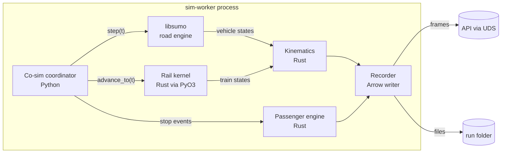
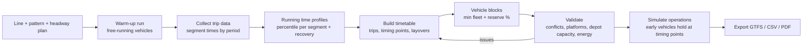
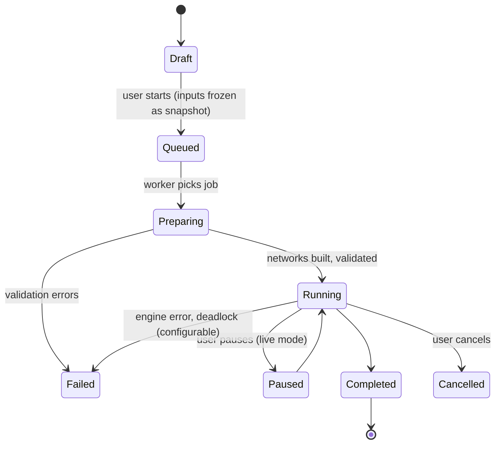

# 07 — Simulation architecture

## 1. Overview

A simulation **run** executes one scenario for one day type (or a calendar range) with one random seed. It has four engines working together inside one `sim-worker` process:

| Engine | Handles | Implementation |
|--------|---------|----------------|
| Road engine | Bus, BRT, trolleybus, intercity bus, background traffic, signals, intersections, bus dwell, road-running trams | Eclipse SUMO via `libsumo` (ADR-0005) |
| Rail engine | Tram (segregated), light rail, metro, commuter, regional, long-distance, high-speed rail; signals, blocks, routes, interlocking, dispatching, platforms | Rust rail operations kernel (ADR-0006) |
| Passenger engine | Boarding, alighting, loads, transfers, denied boardings | Rust, mesoscopic per stop/vehicle (no individual walking agents) |
| Kinematics | Axle, bogie, body section, gangway, coupler poses derived from motion | Rust `kinematics` crate (ADR-0008) |

A **co-simulation coordinator** (Python) advances all engines in lock-step and exchanges state where they interact (ADR-0007).



## 2. Time model

- **Master clock:** simulation seconds since run start, as integer milliseconds (avoids floating-point drift).
- **Road engine:** SUMO fixed step, default 0.5 s (configurable 0.1–1.0 s).
- **Rail engine:** hybrid. Interlocking and dispatching are **event-driven** (route requests, releases, signal aspects change on events). Train motion is integrated with an adaptive step (≤ 1 s, smaller when braking curves or targets are near). The kernel can run far ahead of the road engine except where the two interact.
- **Synchronisation:** at each road step, the coordinator advances the rail kernel to the same time. If no rail/road interaction is pending in the next window (no train within its approach distance of a level crossing or a shared street section), the rail kernel may advance in larger chunks while SUMO catches up. This keeps rail-only scenarios fast.
- **Determinism:** fixed seeds for SUMO (`--seed`) and our RNGs (one stream per subsystem), stable iteration order, no wall-clock reads. Same inputs + version + seed = identical outputs (NFR-ACC-02).

## 3. Road engine (SUMO)

### 3.1 Network and demand generation

1. Export the unified graph's road view to SUMO plain XML, including lanes, bus lanes (`allow="bus"`), trolleybus wires as edge params, traffic signals from OSM (`highway=traffic_signals`) and user-defined signal plans, turn restrictions.
2. `netconvert` (tool-runner) builds `net.net.xml`; validations recorded.
3. Transit: each road vehicle (from the fleet, with its persistent ID) gets a SUMO `vType` derived from its vehicle type (length, width, accel/decel, max speed, `guiShape`, `personCapacity`, `boardingDuration`/`loadingDuration` from the dwell model), and an explicit route with `busStop`s and `stop` elements with `until` (timetable) or `duration`.
4. Background traffic from the demand model's car OD matrix (assigned with `duarouter` or `--routing-algorithm` iterations, or from user-supplied counts with `routeSampler`). This is a declared demand object (C-04).

### 3.2 Persistence inside SUMO

- At run start every transit vehicle is inserted **at its depot slot**, never mid-route (SUMO `depart` at a depot parking area with `departPos` at the slot).
- It drives to its first trip, operates, and returns to the depot. It is removed from SUMO only when it is inside its depot at the end of the run (the persistent `Vehicle` record is unaffected).
- SUMO `teleport` is **disabled** for transit vehicles (`--time-to-teleport -1` globally and `--time-to-teleport.bus -1`). Gridlock is reported as a run warning with location, never "solved" by teleporting. For background traffic teleporting is also disabled by default; the user may enable it for background traffic only, and every teleport is logged as an event.

### 3.3 Dwell model

Dwell = door open/close time + max over door channels of (alighting + boarding × per-passenger time), with per-passenger time depending on floor (low/high), fare collection (on-board, off-board), crowding factor, and number of door channels (from the vehicle's door definitions). Defaults from TCQSM, marked as assumptions. The passenger engine computes boarders/alighters and sends the dwell time to SUMO via `traci.vehicle.setStop(... duration)`.

### 3.4 Trolleybuses and battery buses

Trolleybus edges carry wire availability; off-wire sections use battery. SUMO's battery device (`device.battery`) with our vehicle energy parameters; charging stations at depots and terminals (`chargingStation`). Running out of energy is a run event and the vehicle stops (no magic recharge).

## 4. Rail operations kernel (Rust)

### 4.1 Infrastructure model

| Object | Description |
|--------|-------------|
| `TrackSection` | Directed piece of track with length, gradient profile, curvature, speed limits, electrification, gauge |
| `Switch` | Node with legs and allowed positions; throw time; lock state |
| `Detector` / `TrainDetectionSection` (TDS) | Track circuit or axle counter area used for occupancy |
| `Signal` | Position, direction, type (main, distant, shunting, block), aspects, sighting distance |
| `Route` | Ordered list of TDS and switch positions from an entry signal to an exit signal, with overlap and flank protection |
| `Block` | Automatic block section between signals on plain line |
| `Platform` | Track range + platform edge with height, length; belongs to a station |
| `SpeedRestriction` | Permanent or temporary, with location and value |
| `LevelCrossing` | Linked to a road junction in SUMO |

The model is close to OSRD's RailJSON concepts so test networks can be compared (ADR-0006).

### 4.2 Train dynamics (running-time calculation)

Per train (a consist of one or more vehicle units coupled):

- Tractive effort curve F(v) per unit, from the vehicle file (or derived from power and max tractive effort when only those are known, marked as assumption).
- Resistance: Davis equation `R = A + B·v + C·v²` per consist, plus gradient `m·g·sin(θ)` and curve resistance (Röckl formula default).
- Rotating mass factor.
- Braking: service brake deceleration with jerk limit, emergency braking for safety checks.
- Driving strategy: maximum performance by default; eco-driving (coasting) margin as a configurable percentage of running time supplement.
- Integration: semi-implicit Euler with adaptive step; braking curves computed ahead to next target (signal, speed restriction, stop) so the train never overshoots a red signal.
- Output: position, speed, acceleration, traction power, energy per step.

### 4.3 Signalling and interlocking

- **Fixed block** (default): a train needs an authority up to the next signal showing proceed. Signals show proceed only if the route ahead (blocks/TDS up to the next signal + overlap) is set, locked and clear.
- **Moving block (CBTC-like, simplified)**: authority to the tail of the train ahead minus a safety margin; offered for metro modes.
- **Route setting**: dispatcher requests a route; interlocking checks that all TDS are free, switches can move, no conflicting routes are locked; throws switches (with throw time); locks the route; clears the signal. Sectional route release as the train clears each TDS.
- **Flank protection** and **overlaps** modelled as additional locked elements.
- **Deadlock avoidance**: route requests on single-track sections and station throats use a reservation look-ahead (the dispatcher will not let a train enter a section it cannot leave). Detected deadlocks are run events with a full state dump.

**Safety invariant (tested by property-based tests):** two trains can never be on the same TDS, and no train ever passes a signal at danger in normal operation. This is how "never overlap, never clip" is guaranteed for rail.

### 4.4 Dispatching, platform assignment, rerouting

- **Dispatcher** works from the timetable and real-time state. Priority rules: punctuality-weighted, class priority (HSR > LD > regional > commuter > freight paths) configurable, first-come at conflicts by default.
- **Platform assignment**: preferred platform from the timetable; if occupied or blocked, choose an alternative compatible platform (length, height, side, connected to the route) at runtime. Changes are events visible to the passenger engine (transfers).
- **Rerouting**: on disruption (blocked TDS, failed switch), compute K-shortest alternative paths (Yen, K=5 default) on the rail view of the graph, filter by train compatibility (gauge, electrification, loading gauge, length), pick the best by delay estimate.
- **Algorithms**: Dijkstra and A* for single paths; Yen's K-shortest for alternatives; all on the same in-memory rail graph view.

### 4.5 Scale

Target: 2,000 trains in one simulated day at ≥ 50× real time on one core (NFR-PERF-03). Techniques: event-driven interlocking, struct-of-arrays state, no allocation in the hot loop, spatial index of TDS for occupancy, `rayon` to integrate independent trains in parallel between synchronisation points. Validated by Spike S2 before Phase 4.

### 4.6 Rail depots

Depot tracks are ordinary track sections of type `depot` with storage capacity in metres. Trains start the run stabled on depot tracks. The kernel checks that the sum of stabled train lengths per track ≤ usable length; insufficient capacity raises a design-time warning (FR-NET-10) and a run error if a train cannot be stabled.

## 5. Co-simulation and handover (ADR-0007)

Where rail and road meet:

| Case | Mechanism |
|------|-----------|
| Street-running tram | Tram is simulated **in SUMO** on the street section (vClass `tram`, on tram lanes or shared lanes), and in the rail kernel on segregated sections. Handover at **portal nodes**: the owning engine releases the vehicle; the receiving engine inserts it at the portal only when the entry space is free (otherwise the vehicle waits before the portal). The persistent vehicle ID is kept. No teleport: the handover position is identical. |
| Level crossing | Rail kernel owns the crossing state. When a route over the crossing is set, the coordinator sets the SUMO junction's traffic light to red for road traffic (after a configurable warning time) and the rail route is only cleared after the crossing is confirmed closed. |
| Tram priority at signals | Rail/tram approach triggers SUMO actuated signal priority via TraCI detectors. |
| Bus–rail interchanges | Passenger engine handles transfers between modes; no vehicle interaction. |

## 6. Vehicle geometry and collision prevention (ADR-0008)

- Motion is 1-D along a path in both engines. Collision prevention:
  - Road: SUMO car-following (Krauss default; IDM configurable), junction foe logic, minimum gap. Transit vehicles never teleport.
  - Rail: block/TDS exclusivity and braking curves (§4.3).
  - Depots: road depots are modelled as a SUMO sub-network (aisles as lanes, slots as parking areas), so the same rules apply inside (FR-SIM-09). Rail depots use the rail kernel.
- Geometry is derived every recorded frame:
  - **Rail vehicles:** each axle (and thus each bogie, body section pivot, Jacobs bogie, coupler) is placed at its offset behind the leading axle **along the track path**. Body section orientation = line through its two pivot points; articulation angle between sections; end and centre throw computed for clearance.
  - **Articulated buses:** single-track kinematic model with the trailer hitch, so the rear section tracks inside the front on curves. Pushers and pullers supported by axle definitions.
  - **Gangways and couplers** drawn between section ends.
- Design-time **swept path check**: the same kinematics are run along new alignments and through depot aisles at low speed; the envelope polygon is checked against buildings, platforms and other tracks' envelopes. Violations are validation issues.

## 7. Depots (road)

From the depot polygon and the selected fleet:

1. User marks entrances, exits, and zones (parking, charging, maintenance, reserve, circulation). Or chooses "auto layout".
2. Slot generator packs angled or straight bays per vehicle class (lengths from vehicle types, aisle width from turning-radius envelope) using a strip-packing heuristic; charging slots get chargers.
3. Swept-path check for each slot entry/exit path.
4. Capacity report: slots per class vs fleet incl. reserve %; warnings when insufficient.
5. "Dynamic sizing": suggests the minimum polygon area for a given fleet, and the fleet a given polygon can hold.

Generated layout is a set of persistent objects (slots, aisles) that users can edit.

## 8. Passenger engine

- Demand as OD matrices per period (from the demand model or GTFS-based observed data).
- Passengers are assigned to paths before the run (schedule-based transit assignment); during the run they are **cohorts** (counts per stop, per destination, per path), not individual agents. Boarding respects capacity (seated + standing at a chosen comfort level), producing denied boardings, crowding and wait times.
- This scales to millions of daily trips and supports the persistence rule (C-04): passengers are declared demand, not persistent assets.

## 9. Scenarios and disruptions

| Scenario | Implementation |
|----------|----------------|
| Weekday, weekend, holiday | Day type selects service calendar and demand profile |
| Peak, off-peak | Time windows within a day type; KPIs per window |
| Disruption | Timed events: TDS blocked, road lane closed, station closed, speed restriction |
| Equipment failure | Vehicle failure (stops in place, needs rescue or recovery to depot), door failure (longer dwell), signal failure (signal at danger, degraded operation with caution speed) |
| Infrastructure failure | Switch failure (locked position), power section loss (electric vehicles stop/coast), bridge/tunnel closure |

Events are persistent objects in the scenario (with ID, metadata, audit), scheduled at a time or triggered randomly with a seeded probability model (MTBF/MTTR per asset class, assumptions).

## 10. Multi-year simulation (ADR-0020)

```text
for year in project.simulationYears:
    network_state = base + scenario changes effective in that year (openings, closures)
    fleet_state   = fleet with ages, retirements, procurements
    demand        = base demand × growth factors (assumptions) × network effect (rerun demand model if network changed)
    for day_type in day_types(year):        # weekday-school, weekday-holiday, saturday, sunday, public-holiday × season
        run representative day (micro)
    expand: annual_kpi = Σ day_type_kpi × count_of_days(day_type, year)   # counts from calendar + Nager.Date
```

Users can also pick any specific date and run it fully. Continuous multi-day runs (e.g. a week) are available for depot and charging studies with background traffic disabled or simplified.

## 11. Timetable engine



- Running times: per segment and time period, the chosen percentile (default 85th) of warm-up times, plus recovery margin (default 5–7 % per mode, editable assumption).
- Rail timetables: running-time calculation from §4.2 plus standard supplements; conflict detection on blocking times (the "blocking time stairway" method) across all trains before simulation.
- Vehicle blocks via minimum-cost flow on the trip graph (deadheads from the unified graph). Fleet = peak vehicles in service × (1 + reserve %), default 15 %.
- Holding: vehicles that arrive early at a timing point wait until the scheduled departure (FR-TT-02).
- Calendars: weekday, Saturday, Sunday, holiday service from project preferences and Nager.Date.

## 12. Run lifecycle



Inputs are snapshotted at `Queued` (a content hash of all scenario rows, vehicle files and assumptions), so a run is reproducible and shows exactly what it used.

## 13. Simulation view

- Play, pause, reset, speed (0.5×, 1×, 2×, 5×, 10×, 30×, 60×, 300×, max).
- Two modes: **live** (frames streamed while the run is computed, speed limited by compute) and **replay** (from recorded Parquet, any speed, seek anywhere).
- Viewport-based frame filtering on the server: only vehicles in or near the viewport are sent at full detail; others aggregated.
- Read-only: the editing toolbar is hidden and all write API calls from this view are blocked client-side and rejected server-side for runs.
