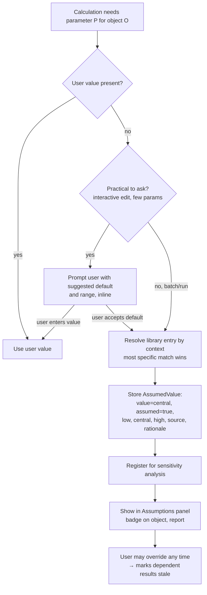
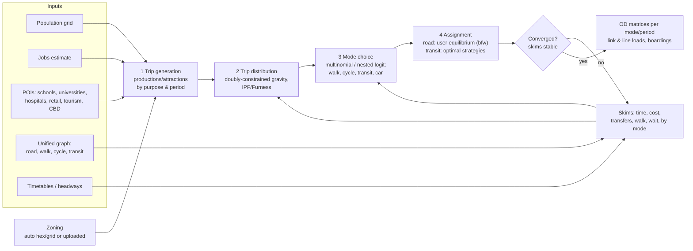

# 09 — Assumptions, demand forecasting and cost estimation

## 1. Assumptions architecture (ADR-0018)

### 1.1 Concepts

| Concept | Description |
|---------|-------------|
| `AssumptionLibraryEntry` | Versioned, sourced default for a named parameter in a context. Example: `dwell.per_boarding_s` for `{mode: bus, fare: onboard, floor: low}` → low 2.5, central 3.5, high 5.0, source TCQSM. Shipped as YAML in the repo (`assumptions/`), reviewed like code. |
| `AssumedValue` | A value stored on an object where the user did not provide one (04 §2.3). |
| `Override` | User-provided value replacing an assumption; keeps a link to the original and records who/when/why. |
| `SensitivityResult` | Effect of varying the assumption from low to high on chosen output metrics. |

### 1.2 Resolution workflow (brief's 8 steps)

- "Practical to ask" = interactive edit with ≤ 5 missing parameters. During a simulation or model run the engine never blocks; it resolves from the library and lists all assumptions in the run report.
- Every library entry has a **basis**: `cited` (a source with page/table reference), `documented` (derived from documented values with the derivation written down), or `educated-guess` (no information available; the maintainers' reasoning is written down and the range is deliberately wide). The basis is shown next to the value everywhere.
- Every parameter has at least one **global fallback entry** in the library (CI fails otherwise), so resolution always finds a value: most specific context first, then mode-level, then global. Nothing is invented at run time.

### 1.3 Sensitivity

- **One-at-a-time:** for each registered assumption, rerun the affected calculation (cost model, demand model) at low and high; produce a tornado chart ranked by output swing. Simulation-level sensitivity runs are opt-in (expensive) and use the batch queue.
- **Monte Carlo (optional):** sample assumptions from their distributions (triangular by default, PERT optional), with seeds; report P10/P50/P90.
- **Switching values** for appraisal: value of an assumption at which BCR = 1 or ENPV = 0.
- The `sensitivity` field on an `AssumedValue` stores the last computed elasticity and rank for its main metric.

### 1.4 No built-in AI

By product owner decision (2026-10-27) there is no AI or LLM component. All values come from the assumption library or from the user.

### 1.5 Project Preferences: every variable is editable

Every value that acts as a variable anywhere in the models (simulation, timetabling, demand, cost, appraisal, validation thresholds, standards, colours, calendars) is listed in the **Project Preferences** window, in a "Parameters" section:

- Grouped by domain (Operations, Vehicles defaults, Infrastructure standards, Demand, Cost, Appraisal, Externalities, Calendar), searchable, with units.
- Each row shows: current value, unit, basis (cited / documented / educated guess / user), source link, low/central/high, where it is used, and a **reset to default** button.
- Editing a value records an override (who, when, optional reason; audited), and marks dependent results (runs, timetables, demand, appraisal) as stale.
- Per-object values (e.g. one vehicle's dwell time) can still be overridden on the object; the preference is the project-wide default.
- Parameters are generated from the assumption library's schema, so a new model variable cannot be added without appearing in Project Preferences (CI check).
- Preferences can be exported/imported as part of the `.mslab` file and copied between projects.

## 2. Demand forecasting architecture (ADR-0019)

Four-step model with AequilibraE as the computational core, orchestrated by the `demand` module and run in `sim-worker`.

### 2.1 Details

| Step | Method | Key assumptions (library) |
|------|--------|---------------------------|
| Zoning | Auto: H3 hexagons (resolution chosen from area) clipped to land, or uploaded zones | H3 is Apache-2.0 |
| Generation | Cross-classification rates per person and per job by purpose (HBW, HBE, HBO, NHB) and period; special generators for universities, hospitals, tourism attractions, CBD uplift | Trip rates per person/day, purpose split, period factors |
| Distribution | Gravity model with deterrence function (combined exponential-power) on generalised cost; doubly constrained for HBW, singly for others | Deterrence parameters per purpose; calibrate to trip-length distribution when observed data exists |
| Mode choice | Nested logit (motorised / non-motorised) with utilities from in-vehicle time, wait, walk, transfers, cost, plus alternative-specific constants | Value of time, coefficients from literature by country income group; ASC calibration to known mode shares if supplied |
| Assignment | Road: bi-conjugate Frank-Wolfe UE; Transit: Spiess–Florian optimal strategies (frequency-based) for planning; schedule-based assignment in the passenger engine for operations | BPR volume-delay parameters |
| Feedback | Skims recomputed from assigned congestion; iterate until relative gap < 1 % or max 10 iterations | |

### 2.2 Catchment and attractiveness effects (FR-DEM-03)

- **Cycle infrastructure** reduces cycling generalised cost on edges with cycle facilities (by facility type), which extends bike-and-ride access to stations: the stop catchment is computed as a network isochrone over walk *and* cycle edges, with cycle parking at stations as a condition.
- **GBFS** stations add a shared-bike access option with availability assumptions.
- **Pedestrian zones** reduce walk disutility (perceived walk time factor < 1) for egress/access in those areas and add an attractiveness term in the transit utility for destinations in pedestrian zones.
- Station accessibility (step-free) adds a penalty for non-step-free access for a configurable share of travellers (mobility-impaired, luggage, prams).

### 2.3 Calibration and validation

Optional observed data: counts, boardings, mode share, trip-length distribution. Calibration adjusts ASCs and deterrence parameters; reports RMSE and GEH statistics. Without observed data the results are flagged "uncalibrated" in every output.

### 2.4 Outputs

OD matrices (OMX format, open standard) per mode and period, link loads, line loads, boardings/alightings per stop, catchment populations, and the demand inputs for the passenger engine.

## 3. Cost estimation architecture

### 3.1 Cost breakdown

| Category | Items | Basis |
|----------|-------|-------|
| Capital (CAPEX) | Track per km by type (surface, elevated, underground bored, cut-and-cover, bridge, ramp), stations by type and platform count, depots, systems (signalling, power, OCS/third rail, communications), vehicles, land, utilities diversion, design & management %, contingency % | Unit cost library (sourced, ranged), optionally benchmarked against Transit Costs Project data (cost per km by country/type) |
| Lifecycle | Renewal cycles per asset class (track 25–40 y, systems 15–25 y, vehicles 25–40 y rail / 12–15 y bus), mid-life overhauls, residual value at end of appraisal period | Asset lifetimes library |
| Operating (OPEX) | Vehicle-km, vehicle-hours, energy (from simulation), staff (drivers per vehicle-hour incl. relief factor), stations, depots, overheads | Unit rates library per country; simulation outputs |
| Maintenance | Per vehicle-km, per track-km, per station, per depot | Library |
| Revenue | Fares × ridership by fare type, elasticity optional | User inputs + assumptions |

Every unit cost is an `AssumedValue` with currency and price-base year. Conversions: World Bank GDP deflators and PPP factors (with source and retrieval date) to the project currency and base year.

### 3.2 Appraisal methods

| Method | Definition used |
|--------|-----------------|
| FNPV | Σ (financial revenues − financial costs)ₜ / (1 + r_f)ᵗ, financial discount rate r_f (default 4 % real, editable) |
| FIRR | r such that FNPV = 0 |
| ENPV | Σ (economic benefits − economic costs)ₜ / (1 + r_s)ᵗ, social discount rate r_s (default per EU guidance 3 %/5 % by cohesion status; editable), with shadow prices / conversion factors applied to financial costs |
| ERR | r such that ENPV = 0 |
| BCR | PV(economic benefits) / PV(economic costs) |
| MCA | Weighted sum (default) or outranking (optional) over user-defined criteria: e.g. accessibility, equity, emissions, integration; weights editable; criteria scored from model outputs or user input |

Default methodology follows the **EU Guide to Cost-Benefit Analysis of Investment Projects (2014)** for structure; national guides (e.g. UK TAG, German BVWP) can be added as alternative method presets. The selected guidance is a `Source`.

### 3.3 Benefits and externalities

| Item | Calculation |
|------|-------------|
| Travel time savings | Δ generalised time from demand model × value of time by purpose (rule-of-half for new users) |
| Vehicle operating cost savings | Δ car-km × unit VOC |
| Emissions (CO₂, NOx, PM) | Δ vehicle-km by mode × emission factor; transit energy from simulation × grid factor; monetised with shadow price of carbon by year |
| Noise | Δ vehicle-km by mode and area type × marginal cost |
| Accidents | Δ vehicle-km × accident rate × cost per casualty |
| Health | Active travel (walk/cycle access) via HEAT-style method (WHO) |
| Congestion | Δ road delay from assignment × value of time |

Default externality unit values from the EU Handbook on the External Costs of Transport (cited, versioned), all overridable.

### 3.4 Sensitivity

As in §1.3, plus standard scenario tests: CAPEX +20 %/+40 %, demand −20 %, delay of opening by 2 years, OPEX +10 %. Switching values for CAPEX and demand.

### 3.5 Outputs

Cash-flow tables per year, appraisal summary, tornado chart, assumptions list, method statement (which formulas and guides), all exportable (XLSX/CSV/PDF) with the source and assumptions appendix.
