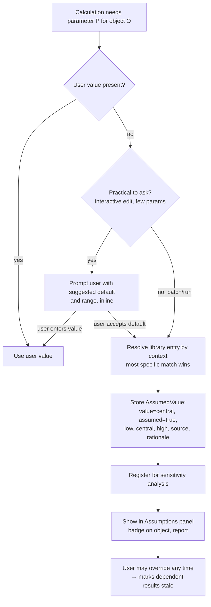
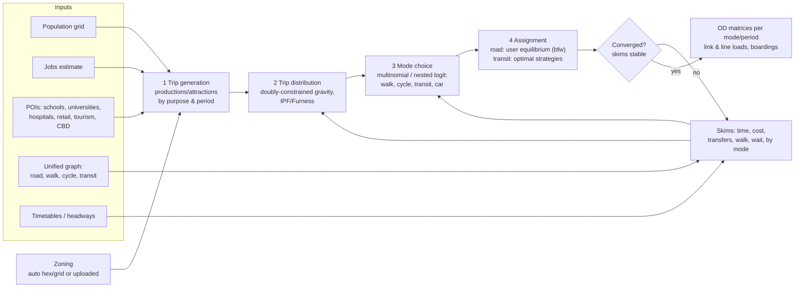

# 09 — Assumptions, demand forecasting and cost estimation

## 1. Assumptions architecture (ADR-0018)

### 1.1 Concepts

| Concept | Description |
|---------|-------------|
| `AssumptionLibraryEntry` | Versioned, sourced default for a named parameter in a context. Example: `dwell.per_boarding_s` for `{mode: bus, fare: onboard, floor: low}` → low 2.5, central 3.5, high 5.0, source TCQSM. Shipped as YAML in the repo ([`assumptions/`](../../assumptions/README.md), readable tables in [`DEFAULTS.md`](../../assumptions/DEFAULTS.md)), reviewed like code. |
| `AssumedValue` | A value stored on an object where the user did not provide one (04 §2.3). |
| `Override` | User-provided value replacing an assumption; keeps a link to the original and records who/when/why. |
| `SensitivityResult` | Effect of varying the assumption from low to high on chosen output metrics. |

### 1.2 Resolution workflow (brief's 8 steps)

- "Practical to ask" = interactive edit with ≤ 5 missing parameters. During a simulation or model run the engine never blocks; it resolves from the library and lists all assumptions in the run report.
- Every library entry has a **basis**: `cited` (a source with page/table reference), `documented` (derived from documented values with the derivation written down), or `educated-guess` (no information available; the maintainers' reasoning is written down and the range is deliberately wide). The basis is shown next to the value everywhere.
- Every parameter has at least one **global fallback entry** in the library (CI fails otherwise), so resolution always finds a value: most specific context first, then mode-level, then global. Nothing is invented at run time.

### 1.3 Sensitivity

- **One-at-a-time:** for each registered assumption, rerun the affected calculation (cost model, demand model) at low and high; produce a tornado chart ranked by output swing. Simulation-level sensitivity runs are opt-in (expensive) and use the batch queue.
- **Monte Carlo (optional):** sample assumptions from their distributions (triangular by default, PERT optional), with seeds; report P10/P50/P90.
- **Switching values** for appraisal: value of an assumption at which BCR = 1 or ENPV = 0.
- The `sensitivity` field on an `AssumedValue` stores the last computed elasticity and rank for its main metric.

### 1.4 No built-in AI

By product owner decision (2026-10-27) there is no AI or LLM component. All values come from the assumption library or from the user.

### 1.5 Project Preferences: every variable is editable

Every value that acts as a variable anywhere in the models (simulation, timetabling, demand, cost, appraisal, validation thresholds, standards, colours, calendars) is listed in the **Project Preferences** window, in a "Parameters" section:

- Grouped by domain (Operations, Vehicles defaults, Infrastructure standards, Demand, Cost, Appraisal, Externalities, Calendar), searchable, with units.
- Each row shows: current value, unit, basis (cited / documented / educated guess / user), source link, low/central/high, where it is used, and a **reset to default** button.
- Editing a value records an override (who, when, optional reason; audited), and marks dependent results (runs, timetables, demand, appraisal) as stale.
- Per-object values (e.g. one vehicle's dwell time) can still be overridden on the object; the preference is the project-wide default.
- Parameters are generated from the assumption library's schema, so a new model variable cannot be added without appearing in Project Preferences (CI check).
- Preferences can be exported/imported as part of the `.mslab` file and copied between projects.

## 2. Demand forecasting architecture (ADR-0019)

Four-step model with AequilibraE as the computational core, orchestrated by the `demand` module and run in `sim-worker`.

### 2.1 Details

| Step | Method | Key assumptions (library) |
|------|--------|---------------------------|
| Zoning | Auto: H3 hexagons (resolution chosen from area) clipped to land, or uploaded zones | H3 is Apache-2.0 |
| Generation | Cross-classification rates per person and per job by purpose (HBW, HBE, HBO, NHB) and period; special generators for universities, hospitals, tourism attractions, CBD uplift | Trip rates per person/day, purpose split, period factors |
| Distribution | Gravity model with deterrence function (combined exponential-power) on generalised cost; doubly constrained for HBW, singly for others | Deterrence parameters per purpose; calibrate to trip-length distribution when observed data exists |
| Mode choice | Nested logit (motorised / non-motorised) with utilities from in-vehicle time, wait, walk, transfers, cost, plus alternative-specific constants | Value of time, coefficients from literature by country income group; ASC calibration to known mode shares if supplied |
| Assignment | Road: bi-conjugate Frank-Wolfe UE; Transit: Spiess–Florian optimal strategies (frequency-based) for planning; schedule-based assignment in the passenger engine for operations | BPR volume-delay parameters |
| Feedback | Skims recomputed from assigned congestion; iterate until relative gap < 1 % or max 10 iterations | |

Built (engine): the worker's `demand` module (`worker/src/mobsim_worker/demand`, AequilibraE 1.7 in memory, no project database) runs generation, distribution, mode choice and assignment for the morning peak, midday, evening peak and evening, plus a night remainder counted in the weekday total. Input is [`contracts/demand-input.schema.json`](../../contracts/demand-input.schema.json): zones with people, jobs and special generators, OpenStreetMap streets, the published lines with headways by period, and GDP per capita and PPP for values of time and costs. Every value is in Project preferences → Demand model, with defaults and sources in [`assumptions/parameters/demand.yaml`](../../assumptions/parameters/demand.yaml). Mode choice is a nested logit over four groups of people (car and bicycle available or not); its logsum is the distribution's travel time. Each period feeds congested car times back with the method of successive averages until the gap target or round limit. Results: trips by mode, period and purpose, road link loads and volume/capacity, line loads, boardings and alightings by stop, the strongest desire lines and the OD matrices as OMX, all marked uncalibrated and credited to AequilibraE. The Tables tab's Demand model section ([user guide](../user/demand-model.md)) builds that input. The zones are automatic hexagons over the model area or the planner's own (uploaded as GeoJSON, drawn in the GIS tab's Demand zones view, with values typed in the zone table). Their values come from WorldPop, OpenStreetMap buildings and places, and the World Bank, unless the planner gives them. The published lines become stopping patterns with headways by period. The streets are not sent: the API adds the OpenStreetMap street tiles around the zones, and the worker builds the street network from them (`demand/osm.py`). The section starts runs and shows the results. Catchment effects (§2.2) are built: perceived cycling distance by cycle facility (OpenStreetMap `cycleway=*` and the GIS tab's bike lanes) and on busy roads, perceived walking distance in pedestrian streets, a car penalty into pedestrian zones, the street setup's lanes and bus lanes, a boarding penalty at stops recorded without step-free access, bike and ride to stops with a bike parking (a second Spiess–Florian graph for people with a bicycle), and shared bikes from OpenStreetMap stations and the project's GBFS feed (cycling for people without a bicycle, and shared-bike access and egress for everyone). Bicycle links lead only to and from a vehicle, and each pattern stop has arriving and departing vertices, so no path skips the vehicle. A run picked in the Demand section (`ridershipRun` in the `demand` drawing) replaces the formula ridership in the benefit tables (and so the service table's Riders column and the fare revenue table) and the system test's passenger loads by stop (`apps/web/src/features/demand/ridership.ts`). Calibration (§2.3) is built.

### 2.2 Catchment and attractiveness effects (FR-DEM-03)

- **Cycle infrastructure** reduces cycling generalised cost on edges with cycle facilities (by facility type), which extends bike-and-ride access to stations: the stop catchment is computed as a network isochrone over walk *and* cycle edges, with cycle parking at stations as a condition.
- **GBFS** stations add a shared-bike access option with availability assumptions.
- **Pedestrian zones** reduce walk disutility (perceived walk time factor < 1) for egress/access in those areas and add an attractiveness term in the transit utility for destinations in pedestrian zones.
- Station accessibility (step-free) adds a penalty for non-step-free access for a configurable share of travellers (mobility-impaired, luggage, prams).

### 2.3 Calibration and validation

Optional observed data: counts, boardings, mode share, trip-length distribution. Calibration adjusts ASCs and deterrence parameters; reports RMSE and GEH statistics. Without observed data the results are flagged "uncalibrated" in every output.

Built: the Demand section's Observed data card (`observed` in the `demand` drawing) takes mode shares, the mean car trip length and weekday boardings of lines and stops (typed or CSV), and sends them with the run (`observed` in the run's settings). The worker (`demand/calibrate.py`) repeats the whole model up to `demand.calibration.max_iterations` times: the transit, walk and cycle constants move by the damped difference of ln(observed/modelled) and car's ln(observed/modelled), or, without shares, the transit constant by ln(observed/modelled) boardings on the matched counts; every purpose's exponential deterrence scales by (modelled/observed mean car km)^damping. It stops when every gap is within `demand.calibration.tolerance`. The result's `calibration` lists observed and modelled shares and trip length, each count with its GEH (the daily count over `demand.calibration.geh_hours`), the %RMSE, the share with GEH under 5, the rounds and the fitted values, which the planner can save to Project preferences. Counts are matched by line or stop id, else by name. A run with only the trip length stays marked uncalibrated.

### 2.4 Outputs

OD matrices (OMX format, open standard) per mode and period, link loads, line loads, boardings/alightings per stop, catchment populations, and the demand inputs for the passenger engine.

## 3. Cost estimation architecture

### 3.1 Cost breakdown

| Category | Items | Basis |
|----------|-------|-------|
| Capital (CAPEX) | Track per km by type (surface, elevated, underground bored, cut-and-cover, bridge, ramp), stations by type and platform count, depots, systems (signalling, power, OCS/third rail, communications), vehicles, land, utilities diversion, design & management %, contingency % | Unit cost library (sourced, ranged), optionally benchmarked against Transit Costs Project data (cost per km by country/type) |
| Lifecycle | Renewal cycles per asset class (track 25–40 y, systems 15–25 y, vehicles 25–40 y rail / 12–15 y bus), mid-life overhauls, residual value at end of appraisal period | Asset lifetimes library |
| Operating (OPEX) | Vehicle-km, vehicle-hours, energy (from simulation), staff (drivers per vehicle-hour incl. relief factor), stations, depots, overheads | Unit rates library per country; simulation outputs |
| Maintenance | Per vehicle-km, per track-km, per station, per depot | Library |
| Revenue | Fares × ridership by fare type, elasticity optional | User inputs + assumptions |

Every unit cost is an `AssumedValue` with currency and price-base year. Conversions: World Bank GDP deflators and PPP factors (with source and retrieval date) to the project currency and base year.

Built (ADR-0039): the Tables tab costs construction (by construction type, set per track in the railway tool), vehicles, depots and operation per mode, per line and in total, low/medium/high, from `assumptions/parameters/costs.yaml` (2023 PPP dollars), converted with the World Bank PPP factor, exchange rate and US GDP deflator. Fare revenue is built too (ADR-0044): boardings from the benefit tables' ridership estimate times the average fare paid under a flat, zonal or distance-based structure, with passes, discount groups, fare elasticity, yearly changes, evasion and collection cost, from `assumptions/parameters/fares.yaml`. Lifecycle and appraisal are not built yet.

### 3.2 Appraisal methods

| Method | Definition used |
|--------|-----------------|
| FNPV | Σ (financial revenues − financial costs)ₜ / (1 + r_f)ᵗ, financial discount rate r_f (default 4 % real, editable) |
| FIRR | r such that FNPV = 0 |
| ENPV | Σ (economic benefits − economic costs)ₜ / (1 + r_s)ᵗ, social discount rate r_s (default per EU guidance 3 %/5 % by cohesion status; editable), with shadow prices / conversion factors applied to financial costs |
| ERR | r such that ENPV = 0 |
| BCR | PV(economic benefits) / PV(economic costs) |
| MCA | Weighted sum (default) or outranking (optional) over user-defined criteria: e.g. accessibility, equity, emissions, integration; weights editable; criteria scored from model outputs or user input |

Default methodology follows the **EU Guide to Cost-Benefit Analysis of Investment Projects (2014)** for structure; national guides (e.g. UK TAG, German BVWP) can be added as alternative method presets. The selected guidance is a `Source`.

### 3.3 Benefits and externalities

| Item | Calculation |
|------|-------------|
| Travel time savings | Δ generalised time from demand model × value of time by purpose (rule-of-half for new users) |
| Vehicle operating cost savings | Δ car-km × unit VOC |
| Emissions (CO₂, NOx, PM) | Δ vehicle-km by mode × emission factor; transit energy from simulation × grid factor; monetised with shadow price of carbon by year |
| Noise | Δ people exposed per 5 dB band from the scenario noise maps × cost per person per dB (ADR-0038); without maps, Δ vehicle-km by mode and area type × marginal cost |
| Accidents | Δ vehicle-km × accident rate × cost per casualty |
| Health | Active travel (walk/cycle access) via HEAT-style method (WHO) |
| Congestion | Δ road delay from assignment × value of time |

**Wider economic and social benefits (ADR-0040).** Until the demand model exists, the Tables tab estimates ridership, GDP growth from agglomeration (TAG A2.4), resident earnings from job access, land value uplift, property tax, construction and operation impacts and access to jobs, education and healthcare from public transport travel times with and without each line (journey planner `reach`), WorldPop, OpenStreetMap buildings and places, and World Bank figures. Formulas and parameters are editable per project; values entered for GIS regions take priority. Only GDP growth is an appraisal benefit; the rest is shown as wider context so nothing is counted twice.

Default externality unit values from the EU Handbook on the External Costs of Transport (cited, versioned), all overridable.

### 3.4 Sensitivity

As in §1.3, plus standard scenario tests: CAPEX +20 %/+40 %, demand −20 %, delay of opening by 2 years, OPEX +10 %. Switching values for CAPEX and demand.

### 3.5 Outputs

Cash-flow tables per year, appraisal summary, tornado chart, assumptions list, method statement (which formulas and guides), all exportable (XLSX/CSV/PDF) with the source and assumptions appendix.
